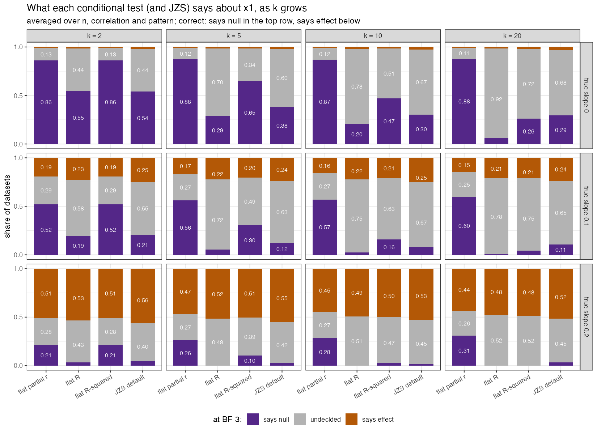

# objective-bayes: what a default prior should keep flat

The research behind [flatcor](https://github.com/dm-k1/flatcor), an R package for objective
Bayes factors and estimation in linear regression: the validation of its three
priors, their comparison, and the argument for its default.

> Define what's possible, not what you expect.

When a default Bayes factor tests one regression coefficient, the answer can
depend on how many other predictors are in the model. Whether it does depends
on what the default prior keeps flat as predictors are added. If each partial
correlation is kept flat (**flat partial r**), the test confirms true nulls at
the same rate for any number of predictors. If the total is kept flat (**flat
R**, **flat R²**), the test drifts with the number of predictors without
becoming more accurate. At 20 predictors all three rank datasets identically, yet flat R
leaves 92% of true nulls undecided while flat partial r confirms 88%. Only
flat partial r's conditional test is also the Bayes factor of one joint model (the full model against its restriction by conditioning, as the Savage–Dickey ratio assumes).



[`docs/findings.md`](docs/findings.md) gives the evidence on one page. All
three priors are built and validated side by side against criteria from the
literature (137 of 138 checks pass; see the [details](docs/4_validation.md)). The comparison, and the
recommendation of flat partial r with its costs, are in
[`docs/3_comparison.md`](docs/3_comparison.md).

## The three priors

The project starts from study 00
([`docs/motivating_simulation.R`](docs/motivating_simulation.R)),
which draws valid correlation matrices of $(y, x_1 \ldots x_k)$. Keeping each
partial correlation flat makes $R^2$ grow with $k$; keeping $R$ or $R^2$ flat
makes each partial correlation shrink towards zero as $k$ grows. That leaves
three options:

| | What is flat | Implied $R^2$ | One coefficient's prior |
|---|---|---|---|
| **flat partial r** (`prior = "flat_partial_r"`) | every valid correlation matrix of $(y, x_1 \ldots x_k)$ | Beta($k/2$, 1), grows with $k$ | a flat partial correlation, for every $k$ |
| **flat R** (`prior = "flat_r"`) | the multiple correlation $R$ | Beta(½, 1), for every $k$ | its share of the flat total; narrows as $k$ grows |
| **flat R²** (`prior = "flat_r_squared"`) | $R^2$ | Beta(1, 1), for every $k$ | its share of the flat total; narrows as $k$ grows |

All three are $R^2$ ~ Beta($a$, 1) with $a$ = $k/2$, ½ or 1. The default is
**flat partial r**, the prior the validation recommends; a function that uses
it because no prior was given says so once per session, and `prior =`
selects the others.

All three divide the total over the predictors without preference. As a
density on the coefficients:

```
P(beta) = P(total) x P(this combination | total) x unit conversion
          R^2 ~ Beta(a, 1)     every split equally likely   noise units -> data units
```

- All three are mixtures of Zellner g-priors (flat R² from two predictors
  on), the family of the JZS default in JASP. The intercept and the noise get
  the same neutral priors as in that family (flat, and $1/\sigma$).
- Flat partial r is the prior of rstanarm's `stan_lm` with η = 1, the only
  shape for which every coefficient's partial correlation is flat.

The package provides estimation with Stan (with `loo()`, `pp_check()` and
bayesplot), Bayes factors between any two linear models from a formula that
needs only $R^2$, $n$ and $k$, and a test for each coefficient.

For the map of the project, see [`docs/0_overview.md`](docs/0_overview.md):
what each claim rests on, how far it is shown, and what to watch out for when
using the package.

## The package and this repository

The package itself, **flatcor**, lives in its own repository,
[dm-k1/flatcor](https://github.com/dm-k1/flatcor): install it with
`remotes::install_github("dm-k1/flatcor")`, and see its README for how to use
it. This repository holds the research around it: the validation, which tests
a fixed release of flatcor (the version pinned in `renv.lock`), the comparison
of the three priors, and the arguments behind the recommendation.

To run the validation, restore the environment with `renv::restore()` (it
installs flatcor at the pinned version, with the other packages), or build the
container from `cluster/Dockerfile`; `docs/4_validation.md` explains how to
run it on any machine.

## What's where

| Path | What it is |
|---|---|
| `docs/findings.md` | **What the project shows**, on one page: the claim, the three results behind it, the costs, what is new |
| `docs/reading_list.md` | What to read before presenting the project: ranked, with what to look for in each, and what has been read |
| `docs/0_overview.md` | **The map**: the fork from study 00, the three priors, the questions the package answers, the status of each claim, what to watch out for, what is open |
| `docs/1_from_behaviour.md` | Where the priors come from: from what valid correlation matrices allow to the three Beta(*a*, 1) forms, with simulated figures |
| `docs/2_how_it_calculates.md` | How it calculates: the density factor by factor, and the Bayes factor |
| `docs/3_comparison.md` | The three priors compared criterion by criterion, with the JZS default and Zellner–Siow as references |
| `docs/4_validation.md` | The validation report: how to run the studies, the criteria from the literature and where each is checked, every result, references |
| `docs/relation_to_others.md` | Which priors drift with the number of predictors; flat partial r as `stan_lm`'s prior; why this is not R2-D2 |
| `docs/motivating_simulation.R` | The motivating simulation: why there are three priors (not part of the validation) |
| `docs/figures/make_figures.R` | Makes every figure in the docs (each a simulation compared with a formula) |
| `docs/ADEMP.md` | The design of the ten validation studies (aims, data, estimands, methods, performance; the number of datasets from a target Monte Carlo SE) |
| `docs/REDESIGN.md` | The working plan of the validation redesign, with its status |
| `R/shared/` | The settings, precision targets and comparison methods every study uses |
| `R/data/` | The shared simulated data sets (A to D), each dataset with its own random stream |
| `R/studies/` | The ten validation studies: correctness (01-04), formal properties (05-06), behaviour (07-10) |
| `R/notebook/` | The notebook's helpers: they present the results, they compute nothing |
| `validation.ipynb` | The validation notebook (R kernel): per study its question, checks, tables and figures; it reads `results/` or reruns the studies |
| `run_all.R` | Runs the studies one after another, without the notebook |
| `results/`, `figures/` | Each study's tables and checks (`study_NN.rds`) and figures, tracked; `results/figures/` still holds the figures of the old studies, which the docs show |
| `cluster/` | Running the validation on a cluster: a SLURM array script and how to use the container with Apptainer |
| `renv.lock`, `cluster/Dockerfile` | The pinned environment: the R packages, and R with packages and CmdStan as a container |

## Scope

Supported: linear regression with a normal outcome, an intercept and fixed
effects, including continuous predictors, factors (tested as one block),
interactions, polynomials and spline columns.

Not (yet) supported, and `fit_regression()` stops for some of these:
group-level (random) effects (the shared $R^2$ total would need the
group-level variance, as in R2D2M2), other families, distributional models,
and models without an intercept.

What to watch out for when using the package (shrinkage at small $n$, the
conditional test with many predictors, variable selection, Stan messages) is
described in [`docs/0_overview.md`](docs/0_overview.md).

## History

- **v1 (March 2026)**, in a separate project, *Computational Bayesian prior
  selection*: an automated prior predictive calibration in brms, with one
  normal scale shared by all predictors so that together they explain at most
  the outcome's variance (scale ≈ 1/√k).
- **v2 (October 2026, this project)**: the exact version, with a closed-form
  Bayes factor and Stan estimation in the prior's own coordinates; first with
  flat R as the default, then with uniform correlations (now flat partial r).
- **v3 (November 2026)**: study 00 showed that not everything can stay flat,
  so the three options (flat partial r, flat R, flat R²) are built and
  validated as equals. The results recommend flat partial r
  (`docs/3_comparison.md`, section 8), which is now the default. The superseded scripts (by-hand
  tutorials, the brms version of the prior, earlier approaches) were in
  `archive/` and remain in the git history up to commit a2886a7.

## Author

Diemithry M. Kloppenburg, University of Amsterdam.

## License

MIT (`LICENSE.md`).
