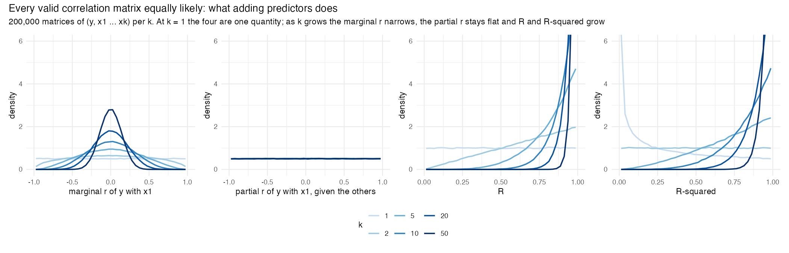

# objective-bayes: what a default prior should keep flat

The research behind [flatcor](https://github.com/dm-k1/flatcor), an R package for objective
Bayes factors and estimation in linear regression: the validation of its three
priors, their comparison, and the argument for its default.

> Define what's possible, not what you expect.

When a default Bayes factor tests one regression coefficient, the answer can
depend on how many other predictors are in the model. Whether it does depends
on what the default prior keeps flat as predictors are added.

With one predictor the answer is easy: a flat prior on the correlation. With
more, draw correlation matrices with every valid matrix equally likely and
watch what the number of predictors $k$ does. One quantity stays flat by
itself, the **partial correlation** of the outcome with each predictor;
the marginal correlation narrows, and the explained variance $R^2$ grows
([`docs/1_why_a_choice.md`](docs/1_why_a_choice.md)):



That leaves three candidate default priors, each flat on one quantity for
every $k$: **flat partial r** (what random matrices give; $R^2 \sim$
Beta($k/2$, 1)), **flat R** and **flat R²** (the total held fixed, so each
partial correlation narrows as $k$ grows). This repository builds all three
in [flatcor](https://github.com/dm-k1/flatcor) and validates them side by
side, with the JZS default and Zellner–Siow as references.

### What the earlier validation found

In the earlier validation (eleven studies, run of 4 November 2026, in which
137 of 138 checks passed), flat partial r's test of one coefficient confirmed
true nulls at the same rate for any number of predictors, while under flat R
and flat R² the test drifted with the number of predictors without becoming
more accurate. At 20 predictors all three ranked datasets identically, yet
flat R left 92% of true nulls undecided while flat partial r confirmed 88%.
Only flat partial r's conditional test was also the Bayes factor of one joint
model (the full model against its restriction by conditioning, as the
Savage–Dickey ratio assumes).


Its findings, comparison and report are kept in
[`docs/working/old_run/`](docs/working/old_run/). The validation has since
been redesigned: ten studies, each with the number of datasets set by a
target Monte Carlo error
([`docs/appendix/C_study_design.md`](docs/appendix/C_study_design.md)). Its
results, presented in [`validation.ipynb`](validation.ipynb), will replace
these numbers.

## Reading order

| | Document | What it is |
|---|---|---|
| 1 | [`docs/1_why_a_choice.md`](docs/1_why_a_choice.md) | **Why a choice is needed**: what adding predictors does to valid correlation matrices, and the three intuitive choices of what stays flat |
| 2 | [`docs/2_the_three_priors.md`](docs/2_the_three_priors.md) | **The three priors**: the family $R^2 \sim$ Beta($a$, 1), what each keeps flat and expects, how the total is divided, what the package computes |
| 3 | [`validation.ipynb`](validation.ipynb) | **The validation**: ten studies, each with its question, PASS/FAIL checks, tables and figures |
| | `docs/3_results.md` | What the validation shows and the recommendation: to be written from the results of the redesigned validation |
| A | [`docs/appendix/A_derivations.md`](docs/appendix/A_derivations.md) | How the prior calculates: the density factor by factor, the Stan model, the Bayes factors, the default-prior criteria |
| B | [`docs/appendix/B_relation_to_other_priors.md`](docs/appendix/B_relation_to_other_priors.md) | How the three relate to JZS, `stan_lm`, R2-D2 and other priors; what is new here and what is not |
| C | [`docs/appendix/C_study_design.md`](docs/appendix/C_study_design.md) | The design of the ten studies (aims, data, estimands, methods, performance) and the number of datasets each needs |

Working notes, not part of the reading path, are in [`docs/working/`](docs/working/):
the plan of the validation redesign, the reading list, and the results of the
earlier validation ([`docs/working/old_run/`](docs/working/old_run/)).

## The three priors

In brief:

| | What is flat | Implied $R^2$ | One coefficient's prior |
|---|---|---|---|
| **flat partial r** (`prior = "flat_partial_r"`) | every valid correlation matrix of $(y, x_1 \ldots x_k)$ | Beta($k/2$, 1), grows with $k$ | a flat partial correlation, for every $k$ |
| **flat R** (`prior = "flat_r"`) | the multiple correlation $R$ | Beta(½, 1), for every $k$ | its share of the flat total; narrows as $k$ grows |
| **flat R²** (`prior = "flat_r_squared"`) | $R^2$ | Beta(1, 1), for every $k$ | its share of the flat total; narrows as $k$ grows |

All three are $R^2$ ~ Beta($a$, 1) with $a$ = $k/2$, ½ or 1. The default is
**flat partial r**, the prior the earlier validation recommended; a function that uses
it because no prior was given says so once per session, and `prior =`
selects the others.

All three divide the total over the predictors without preference. As a
density on the coefficients:

```
P(beta) = P(total) x P(this combination | total) x unit conversion
          R^2 ~ Beta(a, 1)     every split equally likely   noise units -> data units
```

- All three are mixtures of Zellner g-priors (flat R² from two predictors
  on), the family of the JZS default in JASP. The intercept and the noise get
  the same neutral priors as in that family (flat, and $1/\sigma$).
- Flat partial r is the prior of rstanarm's `stan_lm` with η = 1, the only
  shape for which every coefficient's partial correlation is flat.

The package provides estimation with Stan (with `loo()`, `pp_check()` and
bayesplot), Bayes factors between any two linear models from a formula that
needs only $R^2$, $n$ and $k$, and a test for each coefficient
([`docs/2_the_three_priors.md`](docs/2_the_three_priors.md), "What the package
computes with them").

## Names used

| Name used | Means | Also appears as |
|---|---|---|
| **total** | the explained variance $R^2$ of the whole model (flat R keeps its square root $R$ flat) | "shared total" |
| **shape** $a$ | the first parameter of $R^2 \sim$ Beta($a$, 1): $k/2$, ½ or 1 | `r_squared_shape` (Stan), `prior_shape()` |
| **share** | the fraction of the total that one predictor gets; Beta(½, (k−1)/2) for every $a$ | $c^2$ (squared alignment, appendix A section 7), $B$ (appendix A section 8) |
| **noise units**, $f$ | an effect divided by the noise SD $\sigma$; $f^2$ is Cohen's $f^2$ | |
| **joint test** | the Bayes factor of the model with against without a term | |
| **conditional test** | the test of one coefficient's partial correlation | "per-coefficient test" |
| **block route** | a model's $k$ columns tested as one block against none: the whole-model Bayes factor for any $a$ | appendix A, section 7 |
| **flat partial r** | $a = k/2$ | "uniform correlations" (earlier versions), `stan_lm` with η = 1, LKJ(1) |
| **flat R** | $a = ½$ | "flat-R" (earlier versions) |
| **flat R-squared** | $a = 1$ | "flat R²" |
| **references** | JZS default (Cauchy, scale 0.354) and Zellner–Siow (scale 1) | |

---

## Using the package

### What to watch out for

- **Choosing the prior.** Without `prior =`, the functions use flat partial
  r and say so once per session. What each prior assumes is described in
  [`docs/2_the_three_priors.md`](docs/2_the_three_priors.md); the earlier
  validation's recommendation (flat partial r) and its costs are in
  [`docs/working/old_run/comparison.md`](docs/working/old_run/comparison.md),
  section 8.
- **Shrinkage at small $n$.** With several predictors and a small sample, the
  prior pulls estimates towards zero. The example in flatcor ([`inst/examples/example.R`](https://github.com/dm-k1/flatcor/blob/main/inst/examples/example.R)) prints this
  pull next to the ordinary estimates.
- **Flat R and flat R-squared make the conditional test cautious with many
  predictors.** These priors expect each coefficient to be a small share of
  the total, so "no effect" and "a tiny effect" predict nearly the same data.
  Under flat partial r each coefficient keeps a flat partial correlation,
  whatever $k$ is.
- **Leaving the null model.** Against the intercept-only model, evidence for
  the null grows like $a \log n$: ½ log n for flat R and log n for flat
  R-squared, whatever the number of predictors, and $\tfrac k2 \log n$ for
  flat partial r. How strict a variable selection is therefore depends partly
  on the prior over models, which should be chosen deliberately.
- **Under flat partial r the claimed $R^2$ grows with $k$.** The median is .63
  with 3 predictors and .87 with 10, so a large model with a modest fit is
  penalised.
- **Flat R-squared with one predictor is not Jeffreys' prior.** Its prior on
  $r$ has density $|r|$, which gives little weight to correlations near zero.
- **Information consistency needs $n \ge k + 3$**, for all three priors.
- **Main effects with interactions.** `bayes_factor_per_term()` removes one
  term at a time, so testing a main effect while its interaction stays in the
  model is subject to the usual marginality caveats.
- **Stan messages.** At the start of warmup, Stan may print a few
  "Informational Message ... proposal is about to be rejected" lines, because
  the sampler tried $R$ at its boundary. A few of these are harmless; check
  the divergent transitions that `print(fit)` reports.
- **Why the package does not use brms.** brms samples the coefficients
  directly. For $k \ge 2$ the prior has a sharp peak at all-zero coefficients
  that such a sampler misses without warning (appendix A, section 6).

### Scope

Supported: linear regression with a normal outcome, an intercept and fixed
effects, including continuous predictors, factors (tested as one block),
interactions, polynomials and spline columns.

Not (yet) supported, and `fit_regression()` stops for some of these:
group-level (random) effects (the shared $R^2$ total would need the
group-level variance, as in R2D2M2), other families, distributional models,
and models without an intercept.

## Open questions

- **Proofs.** The consistency criteria are checked numerically (study 5), in
  the settings it covers. None is proven analytically
  here, and non-nested models are not covered.
- **The empirical question between the branches:** how explained variance
  grows with the number of predictors in published regressions. Flat partial r
  predicts a median $R^2$ of .76 with 5 predictors; flat R predicts .25 and
  flat R-squared .50 at any size.
- **Benchmarks in variable selection** against the robust, hyper-g/n and
  intrinsic priors (BAS package), and a reanalysis of real data.

## The package and this repository

The package itself, **flatcor**, lives in its own repository,
[dm-k1/flatcor](https://github.com/dm-k1/flatcor): install it with
`remotes::install_github("dm-k1/flatcor")`, and see its README for how to use
it. This repository holds the research around it: the validation, which tests
a fixed release of flatcor (the version pinned in `renv.lock`), the comparison
of the three priors, and the arguments behind the recommendation.

To run the validation, restore the environment with `renv::restore()` (it
installs flatcor at the pinned version, with the other packages), or use the
container image of `cluster/Dockerfile`, which GitHub Actions builds and
publishes as `ghcr.io/dm-k1/flatcor-validation`. Then open
[`validation.ipynb`](validation.ipynb), or run `Rscript run_all.R`;
[`cluster/README.md`](cluster/README.md) describes a run on a cluster.

## What's where

| Path | What it is |
|---|---|
| `docs/1_why_a_choice.md`, `docs/2_the_three_priors.md` | Parts 1 and 2 of the reading path (see "Reading order") |
| `docs/appendix/` | Appendices A (derivations), B (relation to other priors) and C (the design of the ten studies) |
| `docs/figures/` | The figures of the docs |
| `docs/working/` | Working notes: the plan of the redesign (`REDESIGN.md`), the reading list, and the results of the earlier validation (`old_run/`) |
| `R/docs/` | The code behind the docs: the motivating simulation and the figures of parts 1 and 2 |
| `R/shared/` | The settings, precision targets and comparison methods every study uses |
| `R/data/` | The shared simulated data sets (A to D), each dataset with its own random stream |
| `R/studies/` | The ten validation studies: correctness (01-04), formal properties (05-06), behaviour (07-10) |
| `R/notebook/` | The notebook's helpers: they present the results, they compute nothing |
| `validation.ipynb` | The validation notebook (R kernel): per study its question, checks, tables and figures; it reads `results/` or reruns the studies |
| `run_all.R` | Runs the studies one after another, without the notebook |
| `results/`, `figures/` | The results of a run, tracked: each study's tables, checks and setup in `results/studies/study_NN.rds`, the run's summary and session information from `run_all.R` in `results/`, and every figure in `figures/` |
| `cluster/` | Running the validation on a cluster: a SLURM array script and how to use the container with Apptainer |
| `renv.lock`, `cluster/Dockerfile` | The pinned environment: the R packages, and R with packages and CmdStan as a container |

## History

- **v1 (March 2026)**, in a separate project, *Computational Bayesian prior
  selection*: an automated prior predictive calibration in brms, with one
  normal scale shared by all predictors so that together they explain at most
  the outcome's variance (scale ≈ 1/√k).
- **v2 (October 2026, this project)**: the exact version, with a closed-form
  Bayes factor and Stan estimation in the prior's own coordinates; first with
  flat R as the default, then with uniform correlations (now flat partial r).
- **v3 (November 2026)**: the motivating simulation showed that not
  everything can stay flat, so the three options (flat partial r, flat R,
  flat R²) are built and validated as equals. The results of the earlier
  validation recommend flat partial r
  (`docs/working/old_run/comparison.md`, section 8), which is now the default.
  The validation is then redesigned around target Monte Carlo errors. The superseded scripts (by-hand
  tutorials, the brms version of the prior, earlier approaches) were in
  `archive/` and remain in the git history up to commit a2886a7.

## Author

Diemithry M. Kloppenburg, University of Amsterdam.

## License

MIT (`LICENSE.md`).
