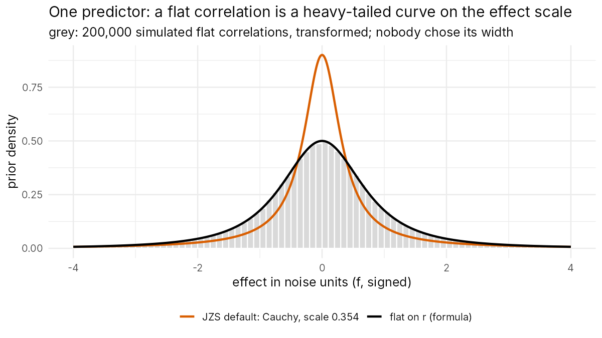
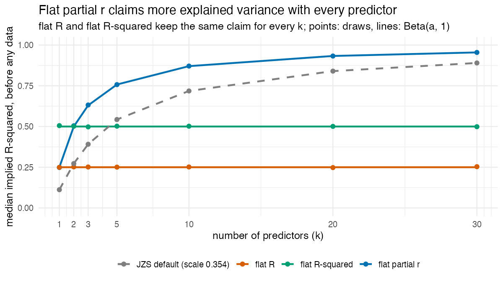
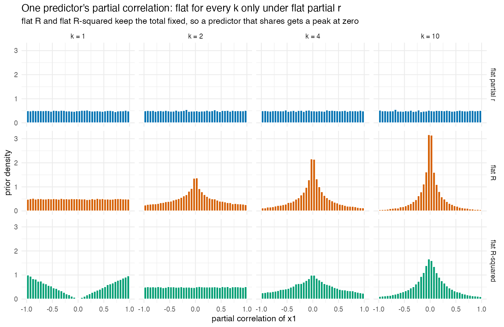

# 1. Where the prior comes from

**In one sentence:** the total strength of all predictors together gets one
flat prior, the same for any number of predictors, and every way of dividing
that total over the predictors is equally plausible.

This document builds that sentence from what effects in a regression can
actually do, in four steps. Each step has a figure that is a simulation, made
by `docs/figures/make_figures.R`. How the sentence becomes a density and a
Bayes factor is in [`2_how_it_calculates.md`](2_how_it_calculates.md).

| Step | What effects can do | What the prior says | A judgement? |
|---|---|---|---|
| 1 | one correlation lies between −1 and 1 | flat on the correlation | yes: which ruler is flat |
| 2 | together, predictors explain at most 100% | the prior goes on the total, $R$ | yes: the total is what gets the prior |
| 3 | the total can be divided in many ways | every division equally plausible | yes: symmetry |
| 4 | — | each predictor's share shrinks as $k$ grows | no: follows from 2 and 3 |

---

## Step 1. One predictor: the correlation is bounded

With one predictor, the whole effect is the correlation $r$ between $x$ and
$y$, and a correlation can only lie between −1 and 1. Saying nothing more
than that, every value equally plausible, is a flat prior on $r$: Jeffreys'
default for a correlation.

On the effect-size scale (the effect in noise units, Cohen's $f$ with a sign,
$f = r/\sqrt{1-r^2}$) the flat correlation becomes a heavy-tailed curve,
$\tfrac12(1+f^2)^{-3/2}$. It resembles the JZS default's Cauchy, but its width
was not chosen: it follows from the bounds of $r$. The JZS default puts more
weight on small effects (orange): that is its built-in expectation.

**The judgement here** is which ruler is flat. Flat on $r$ and flat on $r^2$
are different priors. The correlation is chosen because it is the natural
scale of an effect: bounded, signed, and comparable across studies. (In the
stretched-beta family of Ly, Verhagen & Wagenmakers, flat on $r$ is shape
$a = 1$; a Cauchy on $f$ with scale 1 corresponds to $a = \tfrac12$. The JZS
default's scale 0.354 is not a member of that family: it is narrower.)

---

## Step 2. Several predictors: the bound is on the total

With several predictors, no single coefficient has a bound, but together they
can explain at most all of $y$'s variance: the multiple correlation $R$ lies
between 0 and 1.

A prior per predictor ignores that shared bound. Each predictor brings its own
expected share, so the explained variance the prior claims before seeing data
grows with every predictor added:

| Prior | median implied $R^2$, $k = 1$ | $k = 10$ | $k = 30$ |
|---|---|---|---|
| JZS default (Cauchy, scale 0.354) | 0.11 | 0.72 | 0.89 |
| flat partial correlation per predictor | 0.25 | 0.997 | 1.00 |
| **flat-R** (flat on the total) | 0.25 | 0.25 | 0.25 |

So the flat prior of step 1 goes on the total: **$R$ is flat from 0 to 1, for
any number of predictors.** With one predictor $R = |r|$, so this is exactly
step 1. On the $R^2$ scale it is $\mathrm{Beta}(\tfrac12, 1)$: the same
statement on another ruler.

**The judgement here** is that the total gets the flat prior. The other natural
choice is to make the *correlations* flat: every correlation matrix of
$(y, x_1 \ldots x_k)$ equally likely, or every single correlation flat. Both
agree with step 1 at $k = 1$, and both imply $R^2 \sim \mathrm{Beta}(k/2, 1)$,
so the claimed explained variance grows with $k$ (median 0.63 at $k = 3$, 0.87
at $k = 10$). That is rstanarm `stan_lm`'s $R^2$ prior with η = 1. Flat-R
instead says the total is unknown whatever the number of predictors. Which
describes real studies better is an empirical question: how explained variance
grows with the number of predictors in practice
([`relation_to_others.md`](relation_to_others.md)).

---

## Step 3. Dividing the total: every split equally plausible

A given total can be divided over the predictors in many ways: with two
predictors every point on a circle, with three every point on a sphere. Without
knowing anything about the predictors, every division is equally plausible.

"Equally plausible" is measured in explained variance, so correlated
predictors are handled by the prior itself: two predictors that overlap can't
both claim the shared part.

**The judgement here** is symmetry. It is also the only split that does not
depend on the order or coding of the predictors: a flat Dirichlet on the
shares, for example, gives a different prior when correlated predictors are
listed in another order.

---

## Step 4. What follows: the share per predictor

Steps 2 and 3 fix the total and spread it evenly. What one predictor gets is
then a consequence, not an extra assumption: alone it gets everything (flat);
with others it gets a random slice, on average $1/k$ of the total.

**How large is the slice? Beta(½, (k−1)/2), found the same way as above:
simulate, then derive, then check.**

1. **Simulate.** A direction with no preference is $k$ independent normal draws
   $z_1 \ldots z_k$, divided by their length (in explained-variance units, so
   correlated predictors are already accounted for). Predictor 1's share of the
   total is $z_1^2 / (z_1^2 + \dots + z_k^2)$.
2. **Derive.** The numerator is one squared normal ($\chi^2_1$) and the
   remainder is $k - 1$ of them ($\chi^2_{k-1}$). A $\chi^2_a$ divided by itself
   plus an independent $\chi^2_b$ is Beta($a/2$, $b/2$). So

   $$
   \text{share} \sim \mathrm{Beta}\!\left(\tfrac12, \tfrac{k-1}{2}\right),
   \qquad E[\text{share}] = \frac{1/2}{1/2 + (k-1)/2} = \frac1k .
   $$

3. **Check.** 40,000 directions per $k$: KS distance to that Beta 0.003–0.006,
   mean share 0.501, 0.333, 0.201, 0.100 for $k$ = 2, 3, 5, 10. For $k = 1$ the
   share is 1: the predictor gets the whole total.

Predictor 1's own explained/unexplained variance (its Cohen's $f^2$) is then
share × $R^2/(1-R^2)$ with $R$ flat: the prior of the conditional test
([`2_how_it_calculates.md`](2_how_it_calculates.md), section 10).

- **Expected share per predictor:** $E[R^2]/k = \tfrac{1}{3k}$. Adding
  predictors does not add explained variance to the prior: a built-in
  correction for testing many predictors.
- **Shrinkage:** with several predictors at a small sample, estimates are
  pulled toward zero, because each predictor's share peaks at zero. The pull
  fades as $n$ grows.

---

## What the prior does expect

The motto "define what's possible, not what you expect" holds for the total:
$R$ is flat. It does carry expectations, and they are stated here rather than
left for a reader to find:

- flat on $R$ means $E[R^2] = \tfrac13$ and median $R^2 = 0.25$;
- the per-predictor expectation of step 4 follows from the shared total.
- comparing the models with and without one predictor (the joint test) makes
  its evidence depend on how much the others explain, for the same reason; with
  correlated predictors that test separates nulls from small effects slightly
  worse than the JZS default (`validation/README.md`, study 04). The
  per-coefficient (conditional) test, the default, avoids this (study 05, 06).
- in variable selection there is no extra penalty for leaving the null model:
  against the intercept-only model, evidence for the null grows like
  $\tfrac12\log n$ for any number of predictors (between models that both
  contain an effect, the usual $\tfrac12\log n$ per extra predictor remains;
  [`3_consistency.md`](3_consistency.md)). Flat-R is the most inclusive of the priors compared, and how many predictors enter is
  left to the prior over models (`validation/README.md`, study 09).

Other rulers make other trade-offs. Flat on $R^2$ (Beta(1, 1)) shrinks less
but favours the null more for small effects; the Beta(½, b) family on $R^2$
runs between them. No member gets both properties for free: both come from
how much prior mass sits on small effects.
