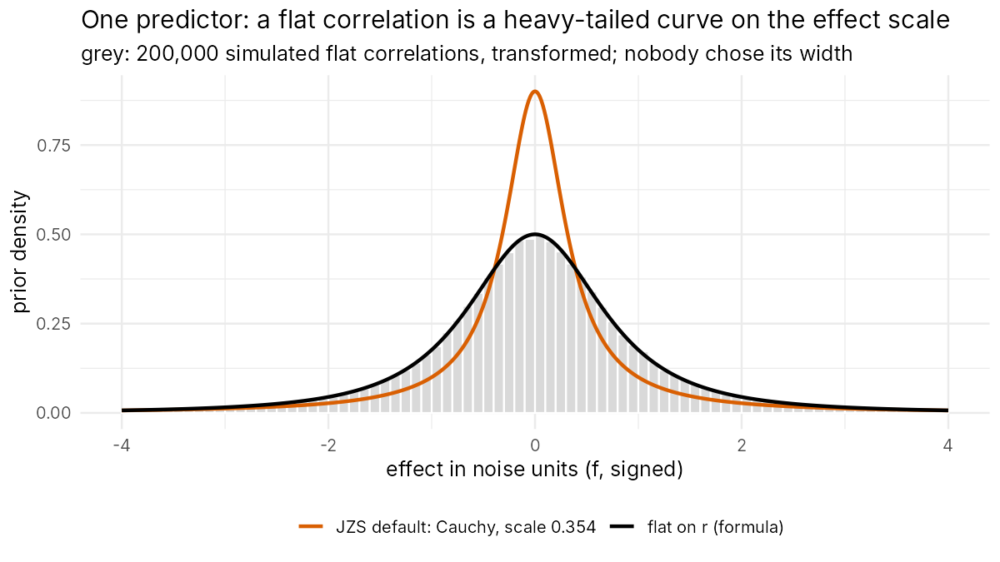
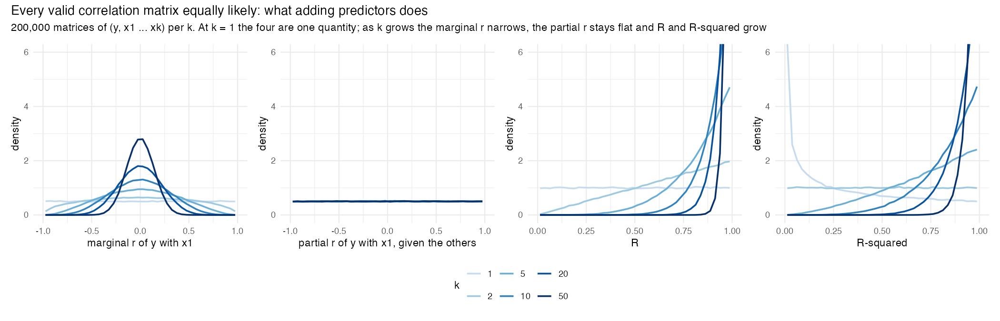
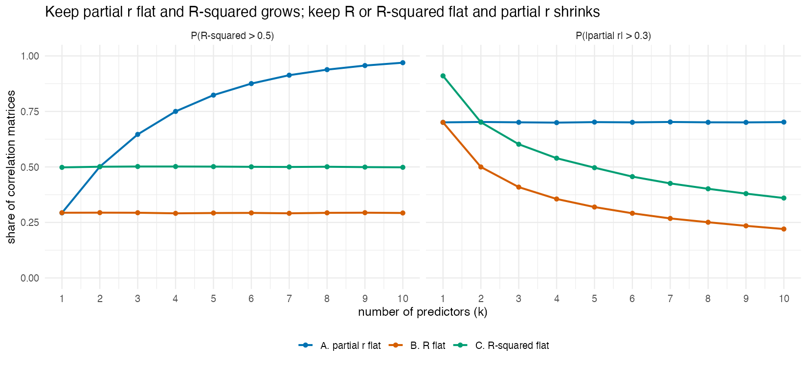
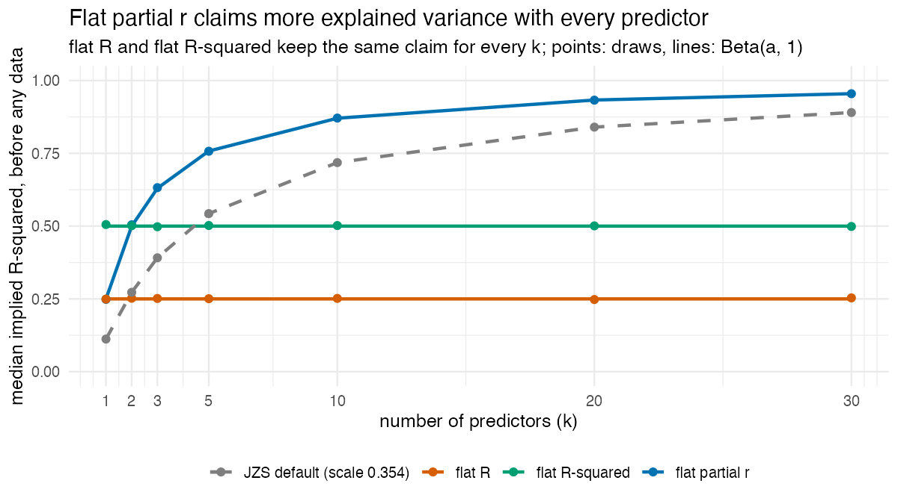

# 1. Why a choice is needed

With one predictor, a flat prior on the correlation is the natural objective
choice. What happens to that choice when predictors are added? This document
answers in four steps. Section 1 states the starting point, a flat
correlation for one predictor. Section 2 makes no further choice: it draws
correlation matrices with every valid matrix equally likely and reports what
the number of predictors $k$ does to them. Section 3 takes the three
quantities one might keep flat (the partial correlation, $R$ and $R^2$) and
shows, analytically and by simulation, how each lines up with that behaviour.
Section 4 says what is left for the validation to decide.

The correlation-matrix figures come from the motivating simulation
([`R/docs/motivating_simulation.R`](../R/docs/motivating_simulation.R)); the
figure of section 1 and the drift figure of section 3 are made by
[`R/docs/make_figures.R`](../R/docs/make_figures.R).

---

## 1. One predictor: a flat correlation

With one predictor, the whole effect is the correlation $r$ between $x$ and
$y$, which can only lie between −1 and 1. Saying nothing beyond that, with
every value equally plausible, gives a flat prior on $r$: Jeffreys' default
for a correlation.

On the effect-size scale, the flat correlation becomes a heavy-tailed curve,
$\tfrac12(1+f^2)^{-3/2}$. Here $f = r/\sqrt{1-r^2}$ is the effect in noise
units (Cohen's $f$ with a sign). The curve resembles the Cauchy of the JZS
default, but its width was not chosen: it follows from the bounds of $r$. The
JZS default (grey in the figure) puts more weight on small effects, which is
its built-in expectation.

This is the one premise of the project: the correlation is the scale on which
an effect is flat. A flat prior on $r$ and a flat prior on $r^2$ are
different priors: flat on $r^2$ gives $r$ the density $|r|$, so correlations
near zero get little weight. The correlation is the natural scale of an
effect, because it is bounded, signed and comparable across studies. In the
stretched-beta family of Ly, Verhagen and Wagenmakers, the flat prior on $r$
is shape $a = 1$, and a Cauchy on $f$ with scale 1 corresponds to
$a = \tfrac12$. The JZS default's scale of 0.354 is narrower and is not a
member of that family.

---

## 2. More predictors: what random correlation matrices do

With several predictors, the correlations of $y$ with the predictors cannot
be chosen one at a time: together with the correlations among the predictors
they must form a valid correlation matrix. The extension of "every
correlation equally plausible" to $k$ predictors is therefore a statement
about the whole matrix of $(y, x_1 \ldots x_k)$: **every valid correlation
matrix equally likely** (the LKJ distribution with η = 1; Lewandowski,
Kurowicka & Joe, 2009). At $k = 1$ this is exactly the flat correlation of
section 1.

The motivating simulation draws such matrices, 200,000 per $k$, for
$k = 1 \ldots 10$, 15, 20, 30, 40 and 50, and records four quantities in
each: the **marginal correlation** of $y$ with $x_1$; the **partial
correlation** (= the correlation of $y$ with $x_1$ after removing the other
predictors from both); the **multiple correlation** $R$ (= the correlation
between $y$ and its best linear prediction from all predictors); and $R^2$.
With one predictor these are one quantity (partial $r = r$, $R = |r|$,
$R^2 = r^2$). As $k$ grows they come apart:

| $k$                        | 1   | 2   | 5   | 10  | 20  | 50  |
| -------------------------- | --- | --- | --- | --- | --- | --- |
| P(\|marginal r\| > .30)    | .70 | .62 | .47 | .32 | .16 | .03 |
| P(\|partial r\| > .30)     | .70 | .70 | .70 | .70 | .70 | .70 |
| P($R^2$ > .50)             | .29 | .50 | .82 | .97 | 1.00 | 1.00 |

- The **marginal correlation** narrows towards 0. Large correlations with $y$
  remain possible (for example when the predictors are highly correlated with
  each other), but matrices that have them become a vanishing fraction of all
  valid matrices as $k$ grows.
- The **partial correlation** stays flat on (−1, 1), for every $k$.
- $R$ and $R^2$ grow towards 1: with more predictors, more of the outcome is
  explained.

So adding predictors to random correlation matrices keeps one quantity flat,
the partial correlation, and moves the others. Given the one extension of
section 1 (every valid matrix equally likely), this is a property of valid
correlation matrices, not of the package's priors or code: the simulation
uses only the matrices.

---

## 3. Three candidates for what stays flat, and how each lines up

A default prior for $k$ predictors could keep one of three quantities flat,
each of which is the flat correlation of section 1 when $k = 1$:

| Candidate | What is flat, for every $k$ | $R^2$ prior | At $k = 1$ |
|---|---|---|---|
| **flat partial r** | each partial correlation | Beta($k/2$, 1) | Jeffreys' flat correlation |
| **flat R** | the multiple correlation $R$ | Beta(½, 1) | Jeffreys' flat correlation ($R = \|r\|$) |
| **flat R-squared** | $R^2$ | Beta(1, 1) | flat on $r^2$, not on $r$ |

All three spread the total over the predictors in the same way, with every
split equally likely ([`2_the_three_priors.md`](2_the_three_priors.md)); they
differ only in the distribution of the total.

**Flat partial r is what random correlation matrices give.** Under "every
valid matrix equally likely":

- the partial correlation of $y$ with any one predictor, given all the
  others, is flat on (−1, 1) for every $k$. The LKJ construction builds the
  matrix from independent partial correlations, and the last of them (two
  variables given all the others) is Beta(η, η) on (−1, 1) whatever the
  number of variables; at η = 1 that is flat ([appendix
  B](appendix/B_relation_to_other_priors.md), "Why η = 1");
- $R^2 \sim$ Beta($k/2$, 1). The conditional variance of one variable given
  the others, $1 - R^2$, is Beta(η, $k/2$) under LKJ(η) (Lewandowski et al.,
  2009), so $R^2 \sim$ Beta($k/2$, η), which is how rstanarm's `stan_lm`
  sets its prior on $R^2$ (Gabry & Goodrich, rstanarm vignette "Estimating
  regularized linear models"). The step-by-step derivation, as a product of
  the partial correlations, is in [appendix
  B](appendix/B_relation_to_other_priors.md), "How Beta($k/2$, 1) was found".

So keeping each partial correlation flat is not a further choice: it is the
behaviour of section 2, and its prior on the total is the total those matrices
imply. The simulation confirms both statements at every $k$ (checks M2 and M3
below).

**Flat R and flat R-squared fix the total instead.** They keep the matrices'
structure (the predictor correlations and the direction of $y$'s correlations
with them) and give the total a distribution that does not change with $k$.
For $k \ge 2$ that is not the total random matrices imply, Beta($k/2$, 1), so
the partial correlation can no longer stay flat: it narrows as $k$ grows.
Flat R agrees with random matrices only at $k = 1$, where $k/2 = ½$; flat
R-squared agrees at no $k$. In the simulation, each version rescales the
size of $y$'s correlations in the same matrices so that $R$, or $R^2$, is
flat (the rescaling keeps every matrix valid, $R < 1$):

| $k$                                      | 1   | 2   | 5   | 10  | 20  | 50  |
| ---------------------------------------- | --- | --- | --- | --- | --- | --- |
| flat partial r: P(\|partial r\| > .30)   | .70 | .70 | .70 | .70 | .70 | .70 |
| flat R: P(\|partial r\| > .30)           | .70 | .50 | .32 | .22 | .14 | .07 |
| flat R-squared: P(\|partial r\| > .30)   | .91 | .70 | .49 | .36 | .25 | .14 |

Flat R keeps P($R^2$ > .50) at .29 and flat R-squared keeps it at .50, for
every $k$; under flat partial r it rises with $k$, as in section 2.

(`figures/motivation_partial_r_R_R2_by_k.png` shows the three distributions of
the partial correlation, $R$ and $R^2$ for selected $k$.)

**A flat prior per predictor does not work either.** Giving each coefficient
its own flat partial correlation, independently, ignores that the predictors
share one outcome. Each predictor then brings its own expected contribution,
and the explained variance the prior claims before seeing data runs to 1:

| Prior                                                              | median implied $R^2$, $k = 1$ | $k = 10$ | $k = 30$ |
| ------------------------------------------------------------------ | --------------------------------- | ---------- | ---------- |
| JZS default (Cauchy, scale 0.354)                                  | .11                              | .72       | .89       |
| independent flat partial correlation per predictor                 | .25                              | .997      | 1.00       |
| **flat partial r** (every correlation matrix equally likely)       | .25                              | .87       | .95       |
| **flat R**                                                         | .25                              | .25       | .25       |
| **flat R-squared**                                                 | .50                              | .50       | .50       |

Under flat partial r the total grows too, but much less, because the partial
correlations of one valid matrix are not independent contributions to the
total.

**Checks** (in the motivating simulation, KS distances against the exact
distribution at every $k$, at the .01 level split over the values of $k$):

- M1: the marginal correlation is Beta($d/2$, $d/2$) on (−1, 1), with
  $d = k + 1$ variables;
- M2: the partial correlation is flat on (−1, 1);
- M3: $R^2$ is Beta($k/2$, 1);
- M4: $R$ is flat in the flat R version, and $R^2$ in the flat R-squared one.

The largest KS distance is .0035, against critical distances of .0045–.0047.
The matrices are drawn as the correlation matrix of a Wishart draw, which is
fast enough for $k = 50$; a two-sample KS test against the vine method of
Lewandowski, Kurowicka and Joe (2009) at $k$ = 1, 3 and 8 finds no difference
(M0; smallest $p$ = .063).

---

## 4. What is left for the validation

Section 3 shows which candidate keeps the behaviour of random correlation
matrices: flat partial r does, flat R does only at $k = 1$, and flat
R-squared does not. That is an argument about where the prior comes from. It
does not yet show that flat partial r makes the better default. Whether it
does is a question about how the three behave as tests and estimates: whether
each computes what it claims, meets the criteria for a default prior, stays
calibrated, and how it confirms nulls, finds effects and selects variables as
predictors are added. The validation answers that for all three, with the JZS
default and Zellner–Siow as references
([`validation.ipynb`](../validation.ipynb); the designs are in [appendix
C](appendix/C_study_design.md)). Under flat R and flat R-squared, one
consequence of section 3 is already predictable: a prior that narrows each
partial correlation as $k$ grows expects each coefficient to be a smaller part
of the total, so its test of one coefficient changes with the number of other
predictors in the model.

The next document, [`2_the_three_priors.md`](2_the_three_priors.md),
describes the three priors as one family and what each expects.
