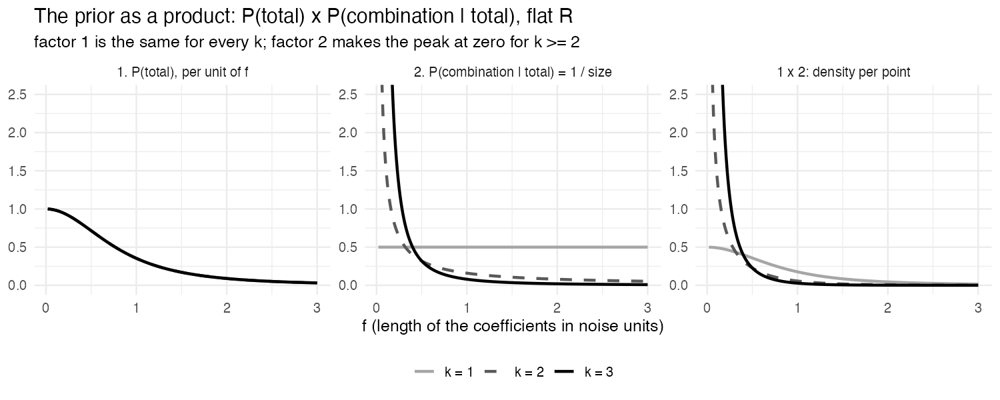
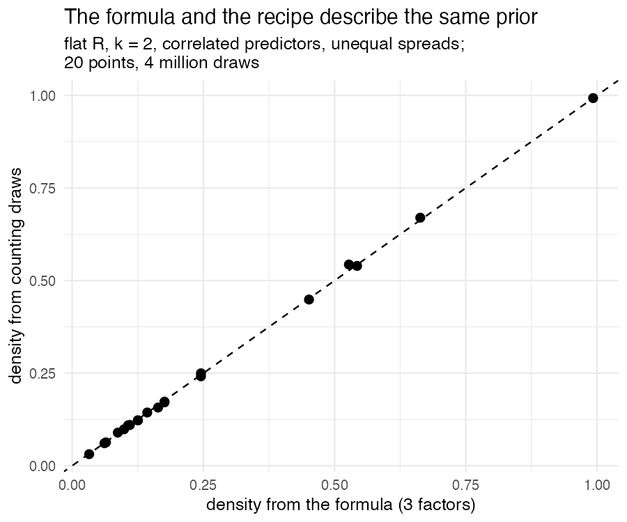
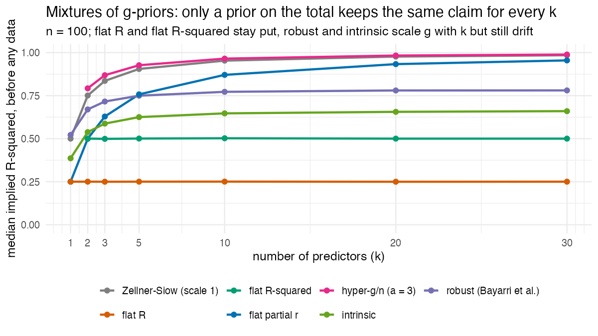

# 2. How the prior calculates

The whole prior in one sentence:

$$
p(\beta \mid \sigma) \;=\; \underbrace{P(\text{total})}_{1}\;\times\;
\underbrace{P(\text{this combination} \mid \text{total})}_{2}\;\times\;
\underbrace{\text{unit conversion}}_{3}
$$

1. **P(total):** how likely is the total effect? Flat on the multiple correlation $R$.
2. **P(this combination | total):** given the total, every way of dividing it
   over the predictors is equally likely.
3. **Unit conversion:** from "noise units" to the units of your predictors and outcome.

Factors 1 and 2 carry the judgements (why: [`1_from_behaviour.md`](1_from_behaviour.md),
steps 2 and 3). Factor 3 carries none: it only converts units, so that the
prior is a density per point of $\beta$, which is what estimation software asks for.

And the Bayes factor in one sentence:

> **The Bayes factor with $k$ predictors is the one-predictor Bayes factor,
> averaged over every direction the effect could take.**

Sections 1–5 build the density, section 6 shows how estimation samples it,
sections 7 and 9 build the Bayes factor (used by `bayes_factor_flat_r()`), and
section 8 places the prior in the known family of mixtures of g-priors.

---

## 1. Model and notation

Linear regression with $n$ observations and $k$ predictors:

$$
y = \alpha \mathbf{1} + X_c \beta + \varepsilon, \qquad \varepsilon \sim N(0, \sigma^2 I_n),
$$

where $X_c$ holds the **centered** predictor columns (each column has mean zero),
so the intercept $\alpha$ is the mean of $y$ and separate from the slopes.

| Symbol | Meaning |
|---|---|
| $\Sigma = X_c^\top X_c / n$ | covariance matrix of the predictors |
| $\beta^\top \Sigma \beta$ | variance explained by the predictors (handles correlated predictors by itself) |
| $\sigma^2$ | unexplained variance (the noise) |
| $f^2 = \beta^\top \Sigma \beta / \sigma^2$ | explained / unexplained variance (**Cohen's $f^2$**) |
| $f$ | the **length of $\beta$ in noise units**: one number for the whole vector |
| $\rho^2 = f^2 / (1 + f^2)$ | **population** explained share of variance; $R = \sqrt{\rho^2}$ |
| $R^2$ (sample) | explained share of the fitted regression |
| $\mathrm{SST} = \sum_i (y_i - \bar y)^2$ | total sum of squares |

**Noise units:** an effect measured with the unexplained spread $\sigma$ as the
ruler, like Cohen's $d$ divides a difference by an SD. $f = 1$ means the
predictors explain as much variance as the noise leaves, so $\rho^2 = 0.5$.

The prior conditions on the observed predictors (they are treated as fixed),
as in Zellner's g-prior and the JZS default. Intercept and noise get the usual
neutral priors (as in JZS): $p(\alpha) \propto 1$, $p(\sigma) \propto 1/\sigma$.
They are improper, but shared by every model being compared, so their constants
cancel in Bayes factors.

---

## 2. Factor 1: P(total), flat on R

$R$ is flat from 0 to 1, for any number of predictors. Equivalently
$\rho^2 = R^2 \sim \mathrm{Beta}(\tfrac12, 1)$, because for $0 \le a \le 1$:

$$
P(\rho^2 \le a^2) = P(R \le a) = a = (a^2)^{1/2},
$$

which is the Beta(½, 1) distribution function.

**Converted to the length $f$.** Estimation needs a density per unit of $f$,
not per unit of $R$. With $R = f / \sqrt{1 + f^2}$:

$$
\frac{dR}{df} = (1 + f^2)^{-3/2}
\qquad\Longrightarrow\qquad
p(f) = \underbrace{1}_{\text{flat on } R} \times (1 + f^2)^{-3/2}, \qquad f > 0 .
$$

Equal slices of $R$ cover longer and longer stretches of $f$ (because $R$
saturates near 1), so the same probability is spread thinner per unit of $f$.
(Check: $\int_0^\infty (1+f^2)^{-3/2} df = [\,f/\sqrt{1+f^2}\,]_0^\infty = 1$.)

---

## 3. Factor 2: P(this combination | total), every split equally likely

Given the total $f$, many coefficient vectors have that length: with two
predictors a whole circle, with $k$ predictors the surface of a sphere of
radius $f$ (in noise units, with the overlap between predictors accounted for).
Every combination on that sphere is equally likely, so the probability of one
combination is 1 divided by the size of all combinations:

$$
P(\text{this combination} \mid f) = \frac{1}{A_k \, f^{k-1}},
\qquad A_k = \frac{2\pi^{k/2}}{\Gamma(k/2)} .
$$

| $k$ | All combinations with length $f$ | Size |
|---|---|---|
| 1 | two points, $+f$ and $-f$ | 2 |
| 2 | a circle | $2\pi f$ |
| 3 | a sphere surface | $4\pi f^2$ |

For $k = 1$ factors 1 and 2 give $\tfrac12 (1+f^2)^{-3/2}$: the flat-correlation
prior on the effect-size scale (figure 1 in `1_from_behaviour.md`), a $t$
distribution with 2 degrees of freedom and scale $1/\sqrt2$ on $\beta/\sigma$.

**The peak at zero.** For $k \ge 2$ the size $A_k f^{k-1}$ goes to 0 as
$f \to 0$, so the density per point has an infinitely high (but integrable)
peak at $\beta = 0$. A sampler that moves through $\beta$ directly misses
that peak for larger $k$, without warnings; that is why estimation samples
$R$ and the direction instead (section 6).

---

## 4. Factor 3: unit conversion

Factors 1 and 2 give a density per point in noise units. The coefficients
$\beta$ are in the units of the data. Converting the axes stretches or squeezes
space, and the density changes by the inverse of that stretch:

$$
\text{unit conversion} = \frac{\sqrt{\det \Sigma}}{\sigma^k} .
$$

It is the same for every $\beta$. In real units the circles of factor 2 become
tilted ellipses (different spreads and correlations between predictors).

---

## 5. The whole density

$$
\log p(\beta \mid \sigma)
= \underbrace{-\tfrac32 \log(1 + f^2)}_{1}
\;\underbrace{-\,\log A_k - (k-1)\log f}_{2}
\;+\underbrace{\tfrac12 \log\det\Sigma - k \log \sigma}_{3},
\qquad f^2 = \frac{\beta^\top\Sigma\beta}{\sigma^2} .
$$

**Drawing from the prior** is the same sentence read forwards:
`draw_coefficients_from_flat_r_prior()` draws $R$ flat (factor 1), a direction
with no preference in explained variance (factor 2), and scales it to length $f$
(factor 3). Counting those draws in small squares gives the formula's density
(figure below; correlated predictors, so factor 3 is tested too).

---

## 6. Estimation: sampling in the prior's own coordinates

The density above is what the prior *says*; it is not how estimation should
*sample* it. Near $\beta = 0$ the density has the peak of section 3, and a
sampler that moves through $\beta$ steps over it without warning (with 8
predictors it draws far too few small effects).

So `inst/stan/flat_r.stan` samples the parameters the prior is built from:

| Parameter | Prior | Factor |
|---|---|---|
| `R` | flat on (0, 1) (on (−1, 1) when $k = 1$: the sign) | 1 |
| `direction` $= z/\lVert z\rVert$ | uniform on the sphere | 2 |
| `sigma`, `alpha` | $1/\sigma$, flat | |

and computes $\beta = \sigma f\, L^{-\top} d$, with $f = R/\sqrt{1-R^2}$, $d$
the direction and $L$ a square root of $\Sigma$ (Cholesky). Then
$\beta^\top \Sigma \beta = \sigma^2 f^2$, so the length is right (factor 3).
Here a matrix root *is* needed: it turns a uniform direction in explained
variance into predictor units. Which root does not matter.

The direction is $z/\lVert z\rVert$ for a free vector $z$. Any density for $z$
that depends only on its length makes the direction uniform; the model uses one
that keeps $\lVert z\rVert$ near 1. Stan's built-in `unit_vector` does the same
with a standard normal $z$, which lets $\lVert z\rVert$ come near 0, where the
direction is undefined; with 2 predictors that gave 1–3 divergent transitions
per 4,000 draws, and none with the length kept near 1.

In these coordinates there is no peak. `validation/01_prior_and_posterior.R`
checks that the prior comes out right for $k$ = 1, 3 and 8, and that the
posterior is calibrated (simulation-based calibration, $k = 8$).

---

## 7. The closed-form Bayes factor

We want the Bayes factor of the model with $k$ predictors against the
intercept-only model,
$\mathrm{BF}_k = p(y \mid k \text{ predictors}) / p(y \mid \text{intercept only})$.

**The one-sentence version:** fix a direction first. Along one direction the
model is a regression on a single constructed predictor, whose Bayes factor we
know. Then average over directions.

### Step 1: one predictor along a fixed direction

Work with the **fitted values** $X_c\beta$ instead of the coefficients. Take any
orthonormal basis $Q$ ($n \times k$) of the columns of $X_c$, for example
`qr.Q(qr(X_c))`, the QR decomposition `lm()` uses. Every vector of fitted
values is $X_c\beta = Q w$ for some $w$ with $k$ entries, and

$$
\lVert w \rVert^2 = \lVert X_c \beta \rVert^2 = n\, \beta^\top \Sigma \beta .
$$

So in $w$ the explained variance is ordinary squared length, and the flat-R
prior reads: length $\lVert w \rVert = \sigma\sqrt n\, f$, direction
$w / \lVert w \rVert$ uniform on the sphere. Which orthonormal basis does not
matter: a uniform direction looks the same in every orientation.

For a fixed direction $d$ (a unit vector), the signal is $\sigma \sqrt n\, f\,(Qd)$:
one predictor $v = Qd$ with $\lVert v \rVert = 1$. Letting $f$ carry a sign
($d$ and $-d$ are equally likely), the coefficient in noise units has density
$\tfrac12(1 + f^2)^{-3/2}$: the one-predictor flat-correlation prior.

The explained share of this one-predictor regression is

$$
R_d^2 = \frac{(v^\top y_c)^2}{\mathrm{SST}} = R^2\, c^2 ,
$$

where $c$ is the **alignment**: the cosine of the angle between $d$ and the
direction the data point in (the least-squares fit, $Q^\top y_c$). Given $d$,
the data enter only through $R^2$ and $c$.

### Step 2: the one-predictor Bayes factor, via g

The one-predictor Bayes factor needs an integral over $\sigma$ (and $\alpha$).
For a *normal* prior on the coefficient that integral has a known closed form:
Zellner's g-prior, where $g$ is the prior variance of the coefficient relative
to the noise. So the flat-correlation prior is written as a mixture of normals:

$$
f \mid g \sim N(0, g/n), \qquad g \sim \text{Inverse-Gamma}(1, \; n/2),
$$

since $\int (g/n)^{-1/2} e^{-nf^2/(2g)}\, g^{-2} e^{-n/(2g)}\, dg \propto (1+f^2)^{-3/2}$.
For each $g$ the g-prior Bayes factor is known (Liang et al., 2008), with
$R_d^2$ in place of $R^2$:

$$
\mathrm{BF}(g, d) = (1+g)^{(n-2)/2}\,\bigl(1 + g(1 - R_d^2)\bigr)^{-(n-1)/2}
= (1+g)^{-1/2} \left(1 - R^2 c^2 \frac{g}{1+g}\right)^{-(n-1)/2} .
$$

The Zellner–Siow (JZS) default uses Inverse-Gamma(½, $n r^2/2$) instead: a
Cauchy on the effect. Shape 1 instead of ½ is the difference between "flat on
the correlation" and "Cauchy on the effect size".

### Step 3: average over g and over directions

For a uniform direction in $k$ dimensions, the alignment $c$ with any fixed
direction has density

$$
p_k(c) \propto (1 - c^2)^{(k-3)/2}, \qquad -1 < c < 1 .
$$

Averaging gives the closed form:

$$
\boxed{\;
\mathrm{BF}_k(R^2, n) = \int_0^\infty \int_{-1}^{1}
\mathrm{IG}(g; 1, n/2)\,(1+g)^{-1/2}
\left(1 - R^2 c^2 \frac{g}{1+g}\right)^{-(n-1)/2} p_k(c)\, dc\, dg
\;}
$$

The data enter only through $R^2$, $n$ and $k$. For $k = 1$ there are only two
directions, both with $c^2 = 1$, and the formula is the one-predictor
flat-correlation Bayes factor.

### Step 4: numerical evaluation

The double integral is evaluated on grids:

- $g$ on a log scale from $10^{-6}$ to $10^{10}$ (800 points); the extra $+\log g$
  in the weights is because the step is in $\log g$;
- $c = \cos\varphi$ with the angle $\varphi$ on a grid over $(0, \pi/2)$ (200 points;
  $\varphi$ and $\pi - \varphi$ give the same $c^2$), so that
  $p_k(c)\,dc \propto \sin^{k-2}\varphi\, d\varphi$, normalized with its exact total.
  The grid is **packed toward $\varphi = 0$** ($\varphi = \tfrac{\pi}{2} q^3$ with $q$
  evenly spaced): when the evidence is strong the integrand is a narrow peak
  there, which an even grid steps over;
- everything on the log scale with log-sum-exp, because terms can be as small
  as $10^{-300}$.

Against adaptive integration (`integrate()`), the largest error over 162
settings ($R^2$ 0.01–0.99, $n$ 10–10,000, $k$ 1–30) is $4 \times 10^{-5}$ on
the log scale (`validation/02_bayes_factor.R`, check A1).

**In the code:** `log_bayes_factor_flat_r_vs_intercept_only()` in `R/bayes_factor.R`:

| Code | Formula |
|---|---|
| `g_values` | $g$ |
| `log_g_weights` | $\log \mathrm{IG}(g; 1, n/2) + \log g$ |
| `shrink_factor` | $g/(1+g)$ |
| `alignment_squared` | $c^2$ |
| `log_direction_weights` | $\log p_k(c)\,dc$ on the packed angle grid |
| `-0.5 * log1p(g_values)` | $(1+g)^{-1/2}$ |
| `log_fit_matrix` | $\log\bigl(1 - R^2 c^2 g/(1+g)\bigr)^{-(n-1)/2}$ plus the direction weight |

---

## 8. The same prior as a mixture of g-priors

**In one sentence:** the flat-R prior is a mixture of Zellner g-priors, and the
only one in that family whose implied $R^2$ is the same for every $k$.

Zellner's g-prior is $\beta \mid g, \sigma \sim N\bigl(0,\ g\,\sigma^2 (X_c^\top X_c)^{-1}\bigr)$:
a uniform direction (in explained variance) with $f^2 = (g/n)\,\chi^2_k$. Putting a
prior on $g$ gives a *mixture of g-priors* (Liang et al., 2008); Zellner–Siow
(JZS), hyper-g, hyper-g/n, beta-prime, robust and intrinsic priors are all
members. The flat-R prior is the member with

$$
\frac{g}{n} = B \cdot W, \qquad B \sim \mathrm{Beta}\!\left(\tfrac12, \tfrac{k-1}{2}\right),
\qquad W \sim \text{Inverse-Gamma}\!\left(1, \tfrac12\right).
$$

- $W$ is the one-predictor part: for $k = 1$, $B = 1$ and this is the
  Inverse-Gamma(1, $n/2$) of section 7, step 2.
- $B$ is the distribution of the squared alignment $c^2$ of section 7: averaging
  over directions there is the same as averaging over $B$ here.
- Why it works: $f^2 = B W \chi^2_k$, and $B\,\chi^2_k$ has the distribution of
  $\chi^2_1$ (a Beta(½, (k−1)/2) share of a $\chi^2_k$ is a $\chi^2_1$). So
  $f^2 = W\chi^2_1$ for every $k$: exactly the one-predictor prior on the total.

The hyperprior density is $p(g/n = t) = \dfrac{1}{2kt^2}\, {}_1F_1\!\left(\tfrac32;
\tfrac k2 + 1; -\tfrac{1}{2t}\right)$ (Kummer's confluent hypergeometric
function). That factor is why it is not a special case of the tCCH family of
Li & Clyde (2018), which covers hyper-g, beta-prime, robust and intrinsic: their
densities are products of powers and an exponential.

**The Bayes factor** is then the standard g-prior Bayes factor averaged over
this hyperprior, a single integral over $g$:

$$
\mathrm{BF}_k = \int_0^\infty (1+g)^{(n-1-k)/2}\,\bigl(1+g(1-R^2)\bigr)^{-(n-1)/2}\, p(g)\, dg ,
$$

which agrees with section 7 to $3.5\times10^{-4}$ on the log scale
(`validation/02_bayes_factor.R`, check A4).

**Where it sits in the family.** Median implied $R^2$ before any data ($n = 100$):

| Prior | $k = 1$ | $k = 3$ | $k = 10$ | $k = 30$ |
|---|---|---|---|---|
| Zellner–Siow (scale 1) | 0.50 | 0.84 | 0.95 | 0.98 |
| hyper-g/n ($a = 3$) | 0.54 | 0.87 | 0.96 | 0.99 |
| robust (Bayarri et al., 2012) | 0.52 | 0.72 | 0.77 | 0.78 |
| intrinsic | 0.39 | 0.59 | 0.65 | 0.66 |
| **flat-R** | 0.25 | 0.25 | 0.25 | 0.25 |
| uniform correlations ($a = k/2$, below) | 0.25 | 0.63 | 0.87 | 0.95 |

The robust and intrinsic priors also scale $g$ with $k$, and drift less, but
still drift.

**The family around it.** The same construction with $R^2 \sim$ Beta($a$, 1)
and a uniform direction is the g-mixture with $B \sim$ Beta($a$, $k/2 - a$) and
the same $W$, for $a \le k/2$ (checked in `validation/09`, V2 and V3).
$a = \tfrac12$ is flat-R. At $a = k/2$, $B \equiv 1$ and $g/n \sim$
Inverse-Gamma(1, ½) for every $k$: the prior you get when every correlation
matrix of $(y, x_1 \ldots x_k)$ is equally likely, and rstanarm `stan_lm`'s
$R^2$ prior with η = 1. Zellner–Siow (scale 1) is $R^2 \sim$ Beta($k/2$, ½)
exactly (its row in the table). How the two ends compare:
[`relation_to_others.md`](relation_to_others.md) and `validation/README.md`, 09.

---

## 9. Comparing any two models

Every model's Bayes factor is taken against the same intercept-only model,
with the same priors on $\alpha$ and $\sigma$. So for any two models A and B
fitted to the same outcome and rows, nested or not:

$$
\mathrm{BF}_{AB} = \frac{\mathrm{BF}_{k_A}(R^2_A, n)}{\mathrm{BF}_{k_B}(R^2_B, n)} .
$$

The evidence for one coefficient (or a block of columns, such as a factor) is
the ratio for the model with and without it. Each model uses the prior with
its own predictors' covariance and its own $k$.

Everything except $g$ and $c$ integrates out exactly, so the Bayes factor needs
no MCMC. It agrees with a brute-force Bayes factor that draws from the prior and
uses no formula (`validation/02_bayes_factor.R`, check A3).

**In the code:** `bayes_factor_flat_r()`.

### Testing one coefficient: the conditional test

**In one sentence:** to test one coefficient, look only at its own contribution
(its partial correlation), with the prior that the joint flat-R prior implies
for one coefficient.

Comparing the models with and without x1 (the *joint* test) judges x1 by how it
moves the total, so it depends on how much the other predictors explain.
Example: x1 has partial correlation 0.2 ($n = 100$, $k = 3$) in two datasets.
When the others explain 5%, the joint Bayes factor for x1 is 2.25; when they
explain 60%, it is 0.70, with the same evidence about x1. This is the
**conditional Lindley paradox** of Som, Hans and MacEachern (2016): every prior
with one scale shared by all coefficients has it, including the JZS default
(weaker; `validation/README.md`, study 04). Its cause is the shared scale.

The conditional test gives the tested coefficient its own scale: its share of
the flat total. With $f$ its effect in noise units,

$$
f^2 = \text{share}\cdot\frac{R^2}{1-R^2}, \qquad R \sim U(0,1), \qquad
\text{share} \sim \mathrm{Beta}\!\left(\tfrac12, \tfrac{k-1}{2}\right),
$$

with a random sign. This is exactly what the joint prior implies for one
coefficient, whatever the correlations between predictors (the alignment of a
uniform direction with one axis has this Beta distribution). The other
coefficients and the intercept get flat priors and the noise $1/\sigma$, the
same under both hypotheses. Integrating them out:

$$
\frac{p(y \mid f)}{p(y \mid 0)} = e^{-nf^2/2}\,\frac{I(\sqrt n\, r f)}{I(0)},
\qquad I(b) = \int_0^\infty v^{m} e^{-v^2/2 + bv}\,dv, \qquad m = n - k - 1,
$$

with $r$ the sample partial correlation. The Bayes factor averages this over the
prior for $f$, and depends only on $r$, $n$ and $k$. With one predictor it equals
the joint test.

What it does (`validation/05`, `06`): it separates nulls from small effects at
least as well as JZS in every design tried, and better with correlated
predictors (AUC +0.03 to +0.045 at correlation 0.7); the joint test does worse
than JZS. With many predictors it is cautious: it rarely calls a small effect
null, but also rarely confirms a null, because the prior expects each
coefficient to be small (on average $1/(3k)$ of the variance), so "no effect"
and "a tiny effect" predict nearly the same data.

**In the code:** `log_bayes_factor_flat_r_conditional()`, used by
`bayes_factor_flat_r_per_term()` for every one-column term. Terms with several
columns (factors with more than two levels) still use the joint test; a block
version, with share ~ Beta($q/2$, $(k-q)/2$) for $q$ columns, is not built yet.

---

## 10. The criteria for a default prior (Bayarri et al., 2012)

Bayarri, Berger, Forte and García-Donato (2012) list seven criteria a default
prior for model choice should meet. Status for the flat-R prior; "argued"
means a short argument below, "checked" means a numerical check in
`validation/02_bayes_factor.R`; "proof" and "sketch" refer to
[`3_consistency.md`](3_consistency.md).

| # | Criterion | Meaning | Status |
|---|---|---|---|
| 1 | Basic | the prior on the tested coefficients is proper, and not arbitrarily vague | **met**, by construction: $p(\beta \mid \sigma)$ integrates to 1 and has no free scale |
| 2 | Model selection consistency | the true model's posterior probability goes to 1 as $n$ grows | **sketch** of the proof for fixed $k$ ([`3_consistency.md`](3_consistency.md)) and checked: under the null (B3, $\log\mathrm{BF}_{01}$ grows like $\tfrac12\log n$, the rate the sketch gives) and under an effect (B4); with $k$ growing with $n$: checked numerically, slower but still growing (`validation/08`) |
| 3 | Information consistency | BF → ∞ as $R^2 \to 1$ | **met for $n \ge k + 3$**: proof in [`3_consistency.md`](3_consistency.md), checked (B2, B2b); not at $n = k + 2$ |
| 4 | Intrinsic consistency | the prior converges to a fixed proper prior as $n$ grows | **met**: proof in [`3_consistency.md`](3_consistency.md) (the prior on $g/n$ does not involve $n$, and $\Sigma_n$ converges) |
| 5 | Predictive matching | on minimal samples ($n = k + 1$) the data cannot separate models: BF = 1 with the null (null matching) and between models of equal size (dimensional matching) | **met**: checked (B1); dimensional matching follows because BF depends only on $R^2$, $n$, $k$, and $R^2 = 1$ for every model at $n = k + 1$ |
| 6 | Measurement invariance | units of the data do not change the answer | **met**, by construction (§7) and checked (A2) |
| 7 | Group invariance | the common parameters get the right-Haar prior, and the prior respects the invariance | **met**: $p(\alpha, \sigma) \propto 1/\sigma$, and $\beta$ is scaled by $\sigma$ |

**Information consistency, the argument.** As $R^2 \to 1$ the g-prior
Bayes factor of section 8 tends to $\int (1+g)^{(n-1-k)/2}\,p(g)\,dg$, so the
Bayes factor grows without limit exactly when that integral diverges (Liang et
al., 2008). For large $g$ the flat-R hyperprior has $p(g/n = t) \approx 1/(2k\,t^2)$
(the confluent hypergeometric factor tends to 1), so the integrand behaves like
$g^{(n-1-k)/2 - 2}$, which diverges if and only if $(n-1-k)/2 - 2 \ge -1$, that
is $n \ge k + 3$. Check B2b confirms the boundary: at $n = k + 2$ the evidence
levels off (e.g. $\log\mathrm{BF} \to 0.91$ for $k = 1$), at $n = k + 3$ it keeps
growing. For comparison, the robust prior of Bayarri et al. needs $n \ge k + 2$.

**Still open:** a full proof of criterion 2 (the sketch's dominated-convergence
steps, and non-nested models), and a proof for $k$ growing with $n$.

---

## 11. Assumptions and limits

- Normal errors, fixed effects, an intercept.
- The prior uses the **sample** covariance of the predictors (it conditions
  on $X$), like the g-prior and JZS.
- The improper priors on $\alpha$ and $\sigma$ are only valid for comparing models
  that share them, which all models here do.
- Not covered: group-level effects, other likelihoods, distributional models.
