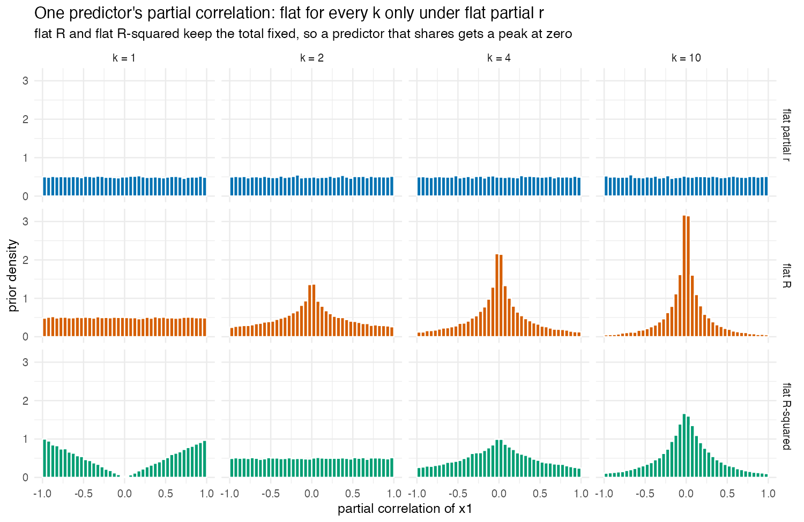

# 2. The three priors

The fork of [`1_why_a_choice.md`](1_why_a_choice.md) leaves three priors, and
they form one family: **$R^2 \sim \mathrm{Beta}(a, 1)$ with a uniform
direction**, where the **direction** (= how the total is split over the
predictors, in explained variance) is equally likely to be any split. They
differ only in the shape $a$. This document describes the family (what each
prior keeps flat, what it expects), describes how the total is divided over the
predictors, and lists what the package computes with
them. How the priors become a density and a Bayes factor is derived in
[appendix A](appendix/A_derivations.md); how they relate to other default
priors is in [appendix B](appendix/B_relation_to_other_priors.md).

---

## What each prior keeps flat

All three priors start from the same principle: the prior weight follows
what is possible (valid correlation matrices), with no scale chosen by
convention. They differ in which quantity they keep flat as predictors are
added.

| | Flat partial r | Flat R | Flat R-squared |
|---|---|---|---|
| `prior =` | `"flat_partial_r"` | `"flat_r"` | `"flat_r_squared"` |
| $R^2$ prior | Beta($k/2$, 1) | Beta(½, 1) | Beta(1, 1) |
| What stays flat as $k$ grows | each partial correlation | the total $R$ | the total $R^2$ |
| What moves as $k$ grows | the total grows (median .25, .63, .87 at $k$ = 1, 3, 10) | each partial correlation narrows | each partial correlation narrows, less than under flat R |
| At $k = 1$ | Jeffreys' flat correlation | Jeffreys' flat correlation | flat on $r^2$: little weight near $r = 0$ |
| Motivating simulation: P(\|partial r\| > .30) at $k$ = 1 / 10 | .70 / .70 | .70 / .22 | .91 / .36 |
| Motivating simulation: P($R^2$ > .50) at $k$ = 1 / 10 | .29 / .97 | .29 / .29 | .50 / .50 |

A prior that spreads its weight evenly always does so on some scale. The one
premise is the scale for one predictor, the correlation
([`1_why_a_choice.md`](1_why_a_choice.md), section 1); section 3 there shows
which of the three keeps what random correlation matrices do as predictors
are added.

---

## The family

The three shapes of $R^2 \sim \mathrm{Beta}(a, 1)$, side by side:

```
                         k = 1: flat on r (Jeffreys)
                                  |
        ---------------------------+---------------------------
        |                          |                          |
  FLAT PARTIAL R              FLAT R                     FLAT R-SQUARED
  every correlation matrix    the total R flat           the total R² flat
  equally likely              for every k                for every k
  a = k/2                     a = 1/2                    a = 1
        |                          |                          |
  R² ~ Beta(k/2, 1)           R² ~ Beta(1/2, 1)          R² ~ Beta(1, 1)
  grows with k                the same for every k       the same for every k
  median 0.25, 0.63, 0.87     median 0.25                median 0.50
  (k = 1, 3, 10)                                         
        |                          |                          |
  per coefficient:            per coefficient:           per coefficient:
  partial r flat on (−1, 1)   its share of the total,    its share of the total,
  for every k (Jeffreys)      narrows as k grows         narrows as k grows
```

| Prior | `prior =` | $a$ | At $k = 1$ | Per coefficient | Where it is derived |
|---|---|---|---|---|---|
| flat partial r | `"flat_partial_r"` | $k/2$ | Jeffreys | flat partial correlation, any $k$ | [appendix B](appendix/B_relation_to_other_priors.md), "How Beta(k/2, 1) was found" |
| flat R | `"flat_r"` | ½ | Jeffreys | share ~ Beta(½, (k−1)/2) of the total | "The share per predictor" below |
| flat R-squared | `"flat_r_squared"` | 1 | flat on $r^2$, not on $r$ | share ~ Beta(½, (k−1)/2) of the total | [appendix A](appendix/A_derivations.md), section 2 |

The default prior is **flat partial r**; a function that uses it because no
prior was given says so once per session, and `prior =` selects the others.
The earlier validation (run of 4 November 2026) recommended flat partial r
and listed its costs ([`working/old_run/comparison.md`](working/old_run/comparison.md),
section 8); the recommendation will be restated from the redesigned
validation. Flat R and flat R-squared remain available.

Flat partial r is the $R^2$ prior of rstanarm's `stan_lm` with η = 1. All
three are mixtures of Zellner g-priors, the family of the JZS default, for the
shapes where such a mixture exists ([appendix A](appendix/A_derivations.md),
section 8). Each Bayes factor is also computed by one route that works for
every $a$ (appendix A, section 7). Each prior has one property that singles it out:

| | Unique property | Shown in |
|---|---|---|
| flat partial r | the only `stan_lm` shape (η = 1) where every coefficient's partial correlation is Jeffreys' flat correlation, whatever $k$ is | [appendix B](appendix/B_relation_to_other_priors.md), "Why η = 1"; study 2, check 2.13 |
| flat R | the only g-mixture whose $R^2$ prior is the same for every $k$ *and* is Jeffreys' prior at $k = 1$ | appendix A, section 8; study 10, check 10.5 |
| flat R-squared | the total explained share is flat on its own scale, for every $k$ | by construction; motivating simulation, check M4 |

---

## Dividing the total: every split equally plausible

A given total can be divided over the predictors in many ways: with two
predictors, any point on a circle; with three, any point on a sphere. Without
knowledge about the predictors, every division is equally plausible. All
three branches make this assumption and differ only in the total.

"Equally plausible" is measured in explained variance, so the prior itself
handles correlated predictors: two predictors that overlap cannot both claim
the shared part.

**The judgement in this step** is symmetry. It is also the only split that
does not depend on the order or coding of the predictors. A flat Dirichlet on
the shares, for example, gives a different prior when correlated predictors
are listed in another order. For flat partial r it is not a separate choice,
because "every correlation matrix equally likely" already implies a uniform
direction.

---

## The share per predictor

The prior on the total and the even split together fix what one predictor
gets. It is a consequence, not an extra assumption: a single predictor gets the
whole total, and with others it gets a random part of it, on average $1/k$.



The size of that part follows a Beta(½, (k−1)/2) distribution for every
branch. This was found by simulating, then deriving, then checking:

1. **Simulate.** A direction with no preference consists of $k$ independent
   normal draws $z_1 \ldots z_k$, divided by their length (in
   explained-variance units, so correlated predictors are already accounted
   for). Predictor 1's share of the total is
   $z_1^2 / (z_1^2 + \dots + z_k^2)$.
2. **Derive.** The numerator is one squared normal ($\chi^2_1$) and the rest
   of the denominator is the sum of $k - 1$ of them ($\chi^2_{k-1}$). A
   $\chi^2_a$ divided by itself plus an independent $\chi^2_b$ follows a
   Beta($a/2$, $b/2$) distribution. So

   $$
   \text{share} \sim \mathrm{Beta}\!\left(\tfrac12, \tfrac{k-1}{2}\right),
   \qquad E[\text{share}] = \frac{1/2}{1/2 + (k-1)/2} = \frac1k .
   $$
3. **Check** (printed by `R/docs/make_figures.R`). With 40,000
   directions per $k$, the KS distance to that Beta distribution is
   .003–.006, and the mean share is .499, .330, .200 and .101 for $k$ = 2, 3,
   5 and 10. For $k = 1$ the share is 1: the predictor gets the whole total.

Predictor 1's own ratio of explained to unexplained variance (its Cohen's
$f^2$) is then share × $R^2/(1-R^2)$, with $R^2 \sim$ Beta($a$, 1). This is
the prior of the conditional test
([appendix A](appendix/A_derivations.md), section 10).

- **Flat partial r** ($a = k/2$): the mixture is exactly a flat partial
  correlation, for every $k$. The total grows with $k$ just fast enough to
  keep each coefficient's partial correlation flat (study 2, checks 2.10 and
  2.11).
- **Flat R and flat R-squared** ($a$ fixed): the total stays where it is and
  the share shrinks, so each coefficient's prior narrows as $k$ grows (the motivating
  simulation, [`1_why_a_choice.md`](1_why_a_choice.md), section 3).

---

## What each prior does expect

The motto "define what's possible, not what you expect" applies to whatever
is kept flat. Each branch still carries expectations, and they are stated here
rather than left for the reader to find:

|                                                                   | Flat partial r                                 | Flat R              | Flat R-squared     |
| ----------------------------------------------------------------- | ---------------------------------------------- | ------------------- | ------------------ |
| $E[R^2]$                                                        | $k/(k+2)$: 1/3, 3/5, 5/6 at $k$ = 1, 3, 10 | 1/3                 | 1/2                |
| median $R^2$                                                    | $0.5^{2/k}$: .25, .63, .87                | .25                | .50               |
| expected explained variance per predictor, $E[\text{share} \times R^2]$ | $1/(k+2)$                                    | $1/(3k)$          | $1/(2k)$         |
| one coefficient's prior                                           | flat partial correlation, any $k$            | narrows with $k$  | narrows with $k$ |
| evidence for the null against the intercept-only model grows like | $\tfrac k2 \log n$                           | $\tfrac12 \log n$ | $\log n$         |

- Under flat R and flat R-squared, adding predictors does not add explained
  variance to the prior. This acts as a built-in correction for testing many
  predictors, and as shrinkage towards zero at small $n$.
- Under flat partial r, each coefficient keeps the same prior whatever the
  model around it, and a large model claims a large total.
- The amount of prior mass near zero sets the rate in the last row:
  $P(R^2 < 1/n) \approx n^{-a}$ for $R^2 \sim$ Beta($a$, 1). Study 5 measures
  this rate as the slope of the evidence against $\log n$ (checks 5.5 and
  5.6).

No branch has every property. The validation measures the trade-offs
([`validation.ipynb`](../validation.ipynb), studies 1–10), and the
recommendation with its costs will be written from its results.

---

## What the package computes with them

| Question | Function | How it computes | Explained in |
|---|---|---|---|
| What are the coefficients? | `fit_regression()` | Stan, sampling $R$ and a direction (not the coefficients) | appendix A, section 6 |
| Which of two models? (nested or not) | `bayes_factor_models()`, `log_bayes_factor_vs_intercept_only()` | exact: needs only $R^2$, $n$, $k$ | appendix A, sections 7–9 |
| Is there evidence for this one coefficient? | `bayes_factor_per_term()`, `log_bayes_factor_conditional()` | the conditional test: its partial correlation, with the prior the joint prior implies for it | appendix A, section 10 |

There are two ways to test one coefficient, and the package uses the second
by default:

| | Joint test (`test = "joint"`) | Conditional test (default) |
|---|---|---|
| What it compares | the model with against without the term | the term's partial correlation against zero |
| Depends on what the other predictors explain? | yes (the conditional Lindley paradox) | no |
| Depends on how many other predictors there are? | yes | flat partial r: no; flat R and flat R-squared: yes (the share shrinks with $k$) |
| Used for | only when asked (`test = "joint"`), or to compare whole models | every term; a term with several columns (a factor with more than two levels) as a block, by its partial $R^2$ |


