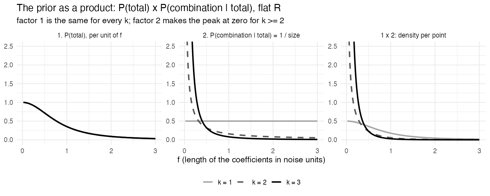
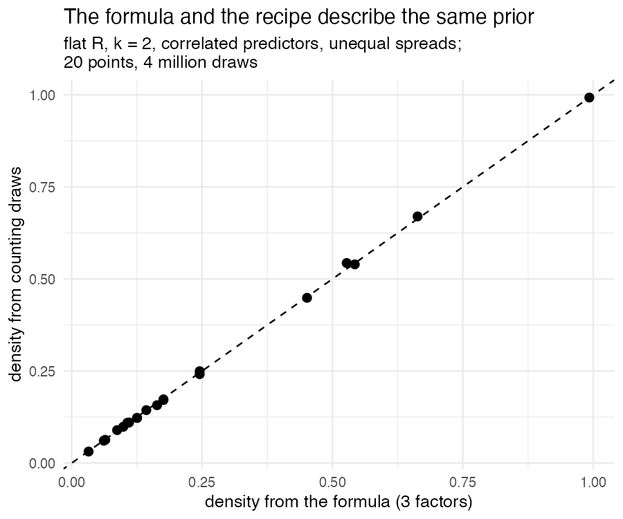
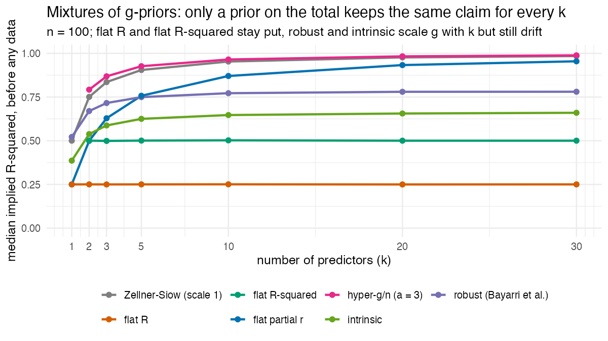

# Appendix A. How the prior calculates

This document covers all three priors: flat partial r
(`prior = "flat_partial_r"`), flat R (`"flat_r"`) and flat R-squared
(`"flat_r_squared"`). They form one family, $R^2 \sim \mathrm{Beta}(a, 1)$ with
a uniform direction and $a = k/2$, ½ or 1, and they differ only in factor 1
below. Where a derivation is written out for one shape (flat R, $a = ½$, in
sections 7 and 8), the general case follows the same steps. Why these priors:
[`1_why_a_choice.md`](../1_why_a_choice.md) and
[`2_the_three_priors.md`](../2_the_three_priors.md).

Checks are named by study and number in the redesigned validation (for
example check 2.5 is study 2, check 5; [appendix C](C_study_design.md) gives
each study's design, and each study's script names the old check it replaces).
Numbers quoted from checks are from the run of the earlier studies of
4 November 2026 (commit 21d42dc, on the `main` branch) unless stated otherwise;
they will be updated from the redesigned validation.

The prior is a product of three factors:

$$
p(\beta \mid \sigma) \;=\; \underbrace{P(\text{total})}_{1}\;\times\;
\underbrace{P(\text{this combination} \mid \text{total})}_{2}\;\times\;
\underbrace{\text{unit conversion}}_{3}
$$

1. P(total) is how likely the total effect is: $R^2 \sim \mathrm{Beta}(a, 1)$,
   which is flat on the correlations ($a = k/2$), flat on $R$ ($a = ½$) or flat
   on $R^2$ ($a = 1$).
2. P(this combination | total) says that, given the total, every way of
   dividing it over the predictors is equally likely.
3. The unit conversion takes the effect from noise units to the units of the
   predictors and the outcome.

Factors 1 and 2 carry the judgements; the reasons are in
[`1_why_a_choice.md`](../1_why_a_choice.md), section 3, and [`2_the_three_priors.md`](../2_the_three_priors.md), "Dividing the total". Factor 3 carries
none. It only converts units, so that the prior becomes a density per point of
$\beta$, which is what estimation software needs.

For flat R, the Bayes factor with $k$ predictors is the one-predictor Bayes
factor, averaged over every direction the effect could take; for other shapes
$a$ the same holds with that prior's distribution of the length $f$ in place of
the one-predictor prior. For any shape $a$, the
same number follows from testing the model's $k$ columns as one block against
none (section 7, step 5, the block route).

| Sections | What | Used by |
|---|---|---|
| 1–5 | the density, factor by factor | `draw_coefficients_from_prior()` |
| 6 | how estimation samples it | `fit_regression()` |
| 7, 9 | the Bayes factor for whole models | `bayes_factor_models()`, `log_bayes_factor_vs_intercept_only()` |
| 8 | the same prior as a mixture of g-priors | `log_bayes_factor_vs_intercept_only()` for flat R-squared with $k \ge 3$; check 2.5 |
| 10 | the test for one coefficient (the conditional test) | `bayes_factor_per_term()`, `log_bayes_factor_conditional()` |
| 11–12 | the default-prior criteria; assumptions and limits | |

How this document fits into the project: [the README](../../README.md).

---

## 1. Model and notation

The model is a linear regression with $n$ observations and $k$ predictors:

$$
y = \alpha \mathbf{1} + X_c \beta + \varepsilon, \qquad \varepsilon \sim N(0, \sigma^2 I_n),
$$

where $X_c$ holds the **centred** predictor columns (each column has mean
zero), so that the intercept $\alpha$ is the mean of $y$ and separate from the
slopes.

| Symbol | Meaning |
|---|---|
| $\Sigma = X_c^\top X_c / n$ | covariance matrix of the predictors |
| $\beta^\top \Sigma \beta$ | variance explained by the predictors (this accounts for correlated predictors by itself) |
| $\sigma^2$ | unexplained variance (the noise) |
| $f^2 = \beta^\top \Sigma \beta / \sigma^2$ | explained divided by unexplained variance (**Cohen's $f^2$**) |
| $f$ | the **length of $\beta$ in noise units**: one number for the whole vector |
| $\rho^2 = f^2 / (1 + f^2)$ | the **population** share of explained variance; $R = \sqrt{\rho^2}$ |
| $R^2$ (sample) | the share of explained variance in the fitted regression |
| $\mathrm{SST} = \sum_i (y_i - \bar y)^2$ | total sum of squares |

Effects are measured in **noise units** (= with the unexplained spread
$\sigma$ as the ruler, as Cohen's $d$ divides a difference by a standard
deviation). For example, $f = 1$ means that the predictors explain as much variance as the
noise leaves unexplained, so $\rho^2 = .5$.

The prior conditions on the observed predictors, which are treated as fixed,
as in Zellner's g-prior and the JZS default. The intercept and the noise get
the usual neutral priors, as in JZS: $p(\alpha) \propto 1$ and
$p(\sigma) \propto 1/\sigma$. These priors are improper, but every model being
compared shares them, so their constants cancel in Bayes factors.

---

## 2. Factor 1: the total, R-squared ~ Beta(a, 1)

Factor 1 sets how likely each size of the total effect is. The population
share $\rho^2 = R^2$ follows $\mathrm{Beta}(a, 1)$, so $P(R^2 \le x) = x^a$,
$P(R \le u) = u^{2a}$, and the density on $R$ is $2a\,R^{2a-1}$.

| Prior | $a$ | Density on $R$ | In words |
|---|---|---|---|
| flat partial r | $k/2$ | $k R^{k-1}$ | every correlation matrix of $(y, x_1 \ldots x_k)$ equally likely |
| flat R | ½ | 1 | $R$ flat for every $k$: $P(R \le u) = u$ |
| flat R-squared | 1 | $2R$ | $R^2$ flat for every $k$ |

With one predictor, flat partial r and flat R are the same prior ($a = ½$),
Jeffreys' flat prior on the correlation.

Estimation needs this density per unit of the length $f$ instead of per unit
of $R$. With $R = f / \sqrt{1 + f^2}$:

$$
\frac{dR}{df} = (1 + f^2)^{-3/2}
\qquad\Longrightarrow\qquad
p(f) = 2a\left(\frac{f^2}{1+f^2}\right)^{a - 1/2} (1 + f^2)^{-3/2}, \qquad f > 0,
$$

and $P(|f| < f_0) = \bigl(f_0^2/(1+f_0^2)\bigr)^a$. For flat R ($a = ½$) the
density is $(1+f^2)^{-3/2}$. Equal slices of $R$ cover longer and longer
stretches of $f$, because $R$ levels off near 1, so the same probability is
spread more thinly per unit of $f$. (As a check,
$\int_0^\infty (1+f^2)^{-3/2} df = [\,f/\sqrt{1+f^2}\,]_0^\infty = 1$.) For flat
R-squared ($a = 1$) the density is $2f(1+f^2)^{-2}$, which is 0 at $f = 0$.

All three have the same tail, $p(f) \approx 2a f^{-3}$ for large $f$. This is
why they share the same boundary for information consistency (section 11).

---

## 3. Factor 2: every split of the total equally likely

Factor 2 spreads a given total evenly over all the ways it can be divided
among the predictors. Many coefficient vectors have the same length $f$: with
two predictors they form a circle, with $k$ predictors the surface of a sphere
of radius $f$ (in noise units, with the overlap between predictors taken into
account). Every combination on that sphere is equally likely, so the
probability of one combination is 1 divided by the size of the set of all
combinations:

$$
P(\text{this combination} \mid f) = \frac{1}{A_k \, f^{k-1}},
\qquad A_k = \frac{2\pi^{k/2}}{\Gamma(k/2)} .
$$

| $k$ | All combinations with length $f$ | Size |
|---|---|---|
| 1 | two points, $+f$ and $-f$ | 2 |
| 2 | a circle | $2\pi f$ |
| 3 | a sphere surface | $4\pi f^2$ |

For $k = 1$, factors 1 and 2 together give $\tfrac12 (1+f^2)^{-3/2}$ for flat
R and flat partial r. This is the flat-correlation prior on the effect-size
scale (figure 1 in `1_why_a_choice.md`), a $t$ distribution with 2 degrees
of freedom and scale $1/\sqrt2$ on $\beta/\sigma$. For flat R-squared they give
$|f|(1+f^2)^{-2}$.

The density has a peak at $\beta = 0$ for flat R with $k \ge 2$ and for flat
R-squared with $k \ge 3$, and none for flat partial r. For $k \ge 2$ the
size $A_k f^{k-1}$ goes to 0 as $f \to 0$, and factor 1 goes to 0 like
$f^{2a-1}$, so the density per point behaves like $f^{2a-k}$ near $\beta = 0$.
That is an infinitely high but integrable peak for flat R ($f^{1-k}$) and for
flat R-squared with $k \ge 3$ ($f^{2-k}$), and no peak for flat partial r
($f^0$). A sampler that moves through $\beta$ directly misses this peak for
larger $k$, without any warning. For that reason estimation samples $R$ and
the direction instead (section 6).

---

## 4. Factor 3: unit conversion

Factor 3 turns the density per point in noise units, which factors 1 and 2
give, into a density per point in the units of the data, which is where the
coefficients $\beta$ live. Changing the axes stretches or squeezes space, and
the density changes by the inverse of that stretch:

$$
\text{unit conversion} = \frac{\sqrt{\det \Sigma}}{\sigma^k} .
$$

The conversion is the same for every $\beta$. In the units of the data, the
circles of factor 2 become tilted ellipses, because predictors differ in
spread and are correlated.

---

## 5. The whole density

Putting the three factors together, on the log scale:

$$
\log p(\beta \mid \sigma)
= \underbrace{\log(2a) + \left(a - \tfrac12\right)\log\frac{f^2}{1+f^2} - \tfrac32 \log(1 + f^2)}_{1}
\;\underbrace{-\,\log A_k - (k-1)\log f}_{2}
\;+\underbrace{\tfrac12 \log\det\Sigma - k \log \sigma}_{3},
\qquad f^2 = \frac{\beta^\top\Sigma\beta}{\sigma^2} .
$$

Drawing from the prior follows the same three factors in order.
`draw_coefficients_from_prior()` draws $R = U^{1/(2a)}$ with $U$ uniform
(factor 1), a direction with no preference in explained variance (factor 2),
and scales it to length $f$ in the units of the data (factor 3). Counting those
draws in small squares reproduces the density of the formula (figure below;
the predictors are correlated, so factor 3 is tested too).

---

## 6. Estimation: sampling in the prior's own coordinates

The density in section 5 describes the prior, but sampling it directly in
$\beta$ works poorly. Near $\beta = 0$ the density has the peak described in
section 3, and a sampler that moves through $\beta$ steps over it without
warning; with 8 predictors it draws far too few small effects.

[`inst/stan/flatcor.stan`](https://github.com/dm-k1/flatcor/blob/main/inst/stan/flatcor.stan) in flatcor therefore samples the parameters from which the prior
is built:

| Parameter | Prior | Factor |
|---|---|---|
| `R_magnitude` $= \lvert R\rvert$ | density $2a\,R^{2a-1}$ on (0, 1) | 1 |
| `direction` $= z/\lVert z\rVert$ | uniform on the sphere | 2 |
| `sigma`, `alpha` | $1/\sigma$, flat | |

With several predictors the sign of each coefficient lives in the direction.
With one predictor the sign of $R$ is + or − with probability ½: the model
averages the likelihood over both signs and draws the sign afterwards, from
the probability the likelihood gives it (flatcor 1.0.1). Sampling a signed $R$
on (−1, 1) instead, as flatcor 1.0.0 did, puts a zero of the density at
$R = 0$ whenever $a > ½$: under flat R-squared the density is $\lvert R\rvert$,
and the sampler has to cross that zero at every change of sign, which gives
divergent transitions.

It then computes $\beta = \sigma f\, L^{-\top} d$, with $f = R/\sqrt{1-R^2}$,
$d$ the direction and $L$ a square root of $\Sigma$ (here the Cholesky factor).
This gives $\beta^\top \Sigma \beta = \sigma^2 f^2$, so the length is correct
(factor 3). A matrix root is needed at this point, because it turns a uniform
direction in explained variance into predictor units; which root is used does
not matter.

The direction is $z/\lVert z\rVert$ for a free vector $z$. Any density for $z$
that depends only on its length makes the direction uniform, and the model
uses one that keeps $\lVert z\rVert$ near 1. Stan's built-in `unit_vector`
does the same with a standard normal $z$, which lets $\lVert z\rVert$ come
close to 0; there the direction is undefined and the sampler can struggle.

The same Stan model serves all three priors, because the prior enters only
through factor 1. The data value `r_squared_shape` is $a$, and one line adds
`target += (2 * r_squared_shape - 1) * log(R_magnitude)` (nothing for $a = ½$).
Factors 2 and 3 are the same for all three.

In these coordinates the prior has no peak. Study 1 (`R/studies/01_prior_sampling.R`)
checks that the prior is reproduced for $k$ = 1, 3 and 8 for each prior
(checks 1.1–1.10), and study 3 that the posterior is calibrated
(simulation-based calibration at $k$ = 3 and 8, all three priors).

---

## 7. The Bayes factor for whole models

This section derives the Bayes factor of the model with $k$ predictors against
the intercept-only model,
$\mathrm{BF}_k = p(y \mid k \text{ predictors}) / p(y \mid \text{intercept only})$.
Steps 1 to 4 build it for flat R ($a = ½$). Step 5 gives a route that works for
every $a$; it checks the closed forms and computes flat R-squared with one
predictor.

The idea is to fix a direction first. Along one direction the model is a
regression on a single constructed predictor, whose Bayes factor is known.
Averaging over directions then gives the Bayes factor for $k$ predictors.

### Step 1: one predictor along a fixed direction

This step rewrites the model so that a fixed direction becomes a single
predictor. Work with the **fitted values** $X_c\beta$ instead of the
coefficients. Take any orthonormal basis $Q$ ($n \times k$) of the columns of
$X_c$, for example `qr.Q(qr(X_c))`, the QR decomposition that `lm()` uses.
Every vector of fitted values is $X_c\beta = Q w$ for some $w$ with $k$
entries, and

$$
\lVert w \rVert^2 = \lVert X_c \beta \rVert^2 = n\, \beta^\top \Sigma \beta .
$$

In $w$, the explained variance is therefore an ordinary squared length, and
the flat R prior reads: length $\lVert w \rVert = \sigma\sqrt n\, f$, and
direction $w / \lVert w \rVert$ uniform on the sphere. The choice of
orthonormal basis does not matter, because a uniform direction looks the same
in every orientation.

For a fixed direction $d$ (a unit vector), the signal is
$\sigma \sqrt n\, f\,(Qd)$, that is, one predictor $v = Qd$ with
$\lVert v \rVert = 1$. If $f$ carries a sign ($d$ and $-d$ are equally likely),
the coefficient in noise units has density $\tfrac12(1 + f^2)^{-3/2}$, the
one-predictor flat-correlation prior.

The share of explained variance in this one-predictor regression is

$$
R_d^2 = \frac{(v^\top y_c)^2}{\mathrm{SST}} = R^2\, c^2 ,
$$

where $c$ is the **alignment** (= the cosine of the angle between $d$ and the
direction of the data, the least-squares fit $Q^\top y_c$). Given
$d$, the data enter only through $R^2$ and $c$.

### Step 2: the one-predictor Bayes factor, through g

The one-predictor Bayes factor needs an integral over $\sigma$ (and $\alpha$),
and that integral has a known closed form when the prior on the coefficient
is normal. This is Zellner's g-prior, in which $g$ is the prior variance of
the coefficient relative to the noise. The flat-correlation prior is therefore
written as a mixture of normal priors:

$$
f \mid g \sim N(0, g/n), \qquad g \sim \text{Inverse-Gamma}(1, \; n/2),
$$

since $\int (g/n)^{-1/2} e^{-nf^2/(2g)}\, g^{-2} e^{-n/(2g)}\, dg \propto (1+f^2)^{-3/2}$.
For each $g$ the g-prior Bayes factor is known (Liang et al., 2008), with
$R_d^2$ in place of $R^2$:

$$
\mathrm{BF}(g, d) = (1+g)^{(n-2)/2}\,\bigl(1 + g(1 - R_d^2)\bigr)^{-(n-1)/2}
= (1+g)^{-1/2} \left(1 - R^2 c^2 \frac{g}{1+g}\right)^{-(n-1)/2} .
$$

The Zellner–Siow (JZS) default uses Inverse-Gamma(½, $n s^2/2$) instead,
which is a Cauchy prior on the effect with scale $s$ (0.354 in BayesFactor and
JASP, 1 for Zellner–Siow). The shape of this hyperprior, 1 instead
of ½, is what separates "flat on the correlation" from "Cauchy on the effect
size".

### Step 3: average over g and over directions

Averaging the Bayes factor of step 2 over $g$ and over directions gives the
Bayes factor for $k$ predictors. For a uniform direction in $k$ dimensions,
the alignment $c$ with any fixed direction has density

$$
p_k(c) \propto (1 - c^2)^{(k-3)/2}, \qquad -1 < c < 1 ;
$$

its square $c^2$ is the **share** of [`2_the_three_priors.md`](../2_the_three_priors.md),
"The share per predictor", which follows Beta(½, (k−1)/2). Averaging gives the closed form:

$$
\boxed{\;
\mathrm{BF}_k(R^2, n) = \int_0^\infty \int_{-1}^{1}
\mathrm{IG}(g; 1, n/2)\,(1+g)^{-1/2}
\left(1 - R^2 c^2 \frac{g}{1+g}\right)^{-(n-1)/2} p_k(c)\, dc\, dg
\;}
$$

The data enter only through $R^2$, $n$ and $k$. For $k = 1$ there are only two
directions, both with $c^2 = 1$, and the formula reduces to the one-predictor
flat-correlation Bayes factor.

### Step 4: numerical evaluation

The double integral of step 3 is evaluated on two grids:

- $g$ on a log scale from $10^{-6}$ to $10^{10}$ (800 points); the weights
  include an extra $+\log g$ because the step is taken in $\log g$;
- $c = \cos\varphi$, with the angle $\varphi$ on a grid over $(0, \pi/2)$ (200
  points; $\varphi$ and $\pi - \varphi$ give the same $c^2$), so that
  $p_k(c)\,dc \propto \sin^{k-2}\varphi\, d\varphi$, normalised with its exact
  total. The grid is **packed towards $\varphi = 0$**
  ($\varphi = \tfrac{\pi}{2} q^3$ with $q$ evenly spaced), because when the
  evidence is strong the integrand is a narrow peak there that an even grid
  would step over.

Everything is computed on the log scale with log-sum-exp, because terms can be
as small as $10^{-300}$.

Against adaptive integration (`integrate()`), the largest error over 162
settings ($R^2$ .01–.99, $n$ 10–10,000, $k$ 1–30) is $4 \times 10^{-5}$ on
the log scale (study 2, check 2.1).

In the code, this is `log_bayes_factor_flat_r_vs_intercept_only()` in
[`R/bayes_factor.R`](https://github.com/dm-k1/flatcor/blob/main/R/bayes_factor.R) in flatcor (internal; `log_bayes_factor_vs_intercept_only(..., prior = "flat_r")`
calls it):

| Code | Formula |
|---|---|
| `g_values` | $g$ |
| `g_grid$log_weights` (from `inverse_gamma_g_grid()`) | $\log \mathrm{IG}(g; 1, n/2) + \log g$ + log grid step |
| `shrink_factor` | $g/(1+g)$ |
| `alignment_squared` | $c^2$ |
| `log_direction_weights` | $\log p_k(c)\,dc$ on the packed angle grid |
| `-0.5 * log1p(g_values)` | $(1+g)^{-1/2}$ |
| `log_fit_matrix` | $\log\bigl(1 - R^2 c^2 g/(1+g)\bigr)^{-(n-1)/2}$ plus the direction weight |

---

### Step 5: any shape a, the block route

For any shape $a$, the whole-model Bayes factor can also be computed by
testing the model's $k$ columns as one block against none, which is the same
question as the whole model against the intercept-only model. Section 10
gives the block likelihood ratio for a length $f$ in noise units with a
uniform direction; with $q = k$ it is

$$
\frac{p(y \mid f)}{p(y \mid 0)} = e^{-nf^2/2}\, {}_1F_1\!\left(\tfrac{n-1}{2}; \tfrac k2; \tfrac{n R^2 f^2}{2}\right),
$$

(in the notation of section 10, $m = n - k + q - 2 = n - 2$), and the Bayes
factor is its average over factor 1,

$$
\mathrm{BF}_k = \int_0^\infty e^{-nf^2/2}\, {}_1F_1\!\left(\tfrac{n-1}{2}; \tfrac k2; \tfrac{n R^2 f^2}{2}\right)
\, dP(|f| < f_0), \qquad P(|f| < f_0) = \left(\frac{f_0^2}{1+f_0^2}\right)^{a}.
$$

The code takes this average on a grid in $f$ around the peak of the
likelihood ratio, weighting each cell by its exact prior probability (a
difference of the cumulative distribution function), as the conditional test
does. With few residual degrees of freedom ($n - k < 10$) it adds a log grid
from $10^{-8}$ to $10^{8}$, where the likelihood ratio is broad (study 5, check 5.3).

- The block route reproduces the closed forms. With $a = ½$ it gives flat R's
  Bayes factor of steps 1 to 4, and with $a = k/2$ flat partial r's (section
  8), within $2\times10^{-4}$ on the log scale
  ([`tests/testthat/test-three-priors.R`](https://github.com/dm-k1/flatcor/blob/main/tests/testthat/test-three-priors.R) in flatcor; study 2, check 2.5). It therefore
  serves as a check on the closed forms, and as the route for flat R-squared
  with one predictor, where no g-mixture exists (section 8). The closed forms
  are used wherever they exist, because they are faster.
- At $n = k + 1$ every model fits the data exactly ($R^2 = 1$), and the data
  say nothing about the effect; the Bayes factor is then 1 for any proper
  prior on it (predictive matching, Bayarri et al., 2012). The closed forms
  give 1 there, and the block route returns 1 directly, because its grid needs
  $n \ge k + 2$.
- With very strong evidence the average over directions, a Bessel function
  $I_\nu(t)$ with $\nu = k/2 - 1$, needs an expansion. Above $t = 10^4$, R's
  `besselI()` loses accuracy, and beyond about $10^5$ it returns 0, so in that
  range the large-argument expansion
  $I_\nu(t)\,e^{-t} = (2\pi t)^{-1/2}\bigl(1 - \tfrac{4\nu^2-1}{8t} +
  \tfrac{(4\nu^2-1)(4\nu^2-9)}{2(8t)^2} - \dots\bigr)$ is used. Its error on
  the log scale at $t = 10^4$ is below $10^{-12}$ up to 15 columns,
  $4\times10^{-10}$ at 30 and $10^{-7}$ at 60. The expansion also keeps the
  block conditional test exact at extreme evidence.

In the code, `log_bayes_factor_vs_intercept_only(r_squared, n, k, prior)`
computes flat R and flat partial r through their closed forms. Flat R-squared
uses its g-mixture for $k \ge 3$ (section 8; the hyperprior grid is computed
once per $k$ and kept), the flat partial r closed form at $k = 2$ (the two
priors coincide there), and `log_bayes_factor_shape_vs_intercept_only()` (the
block route, internal) at $k = 1$.

---

## 8. The same prior as a mixture of g-priors

The family $R^2 \sim$ Beta($a$, 1) with a uniform direction is a family of
mixtures of Zellner g-priors (for $a \le k/2$). Within it, flat R is the only
member whose implied $R^2$ is the same for every $k$ *and* equals Jeffreys'
flat correlation at $k = 1$.

Zellner's g-prior is $\beta \mid g, \sigma \sim N\bigl(0,\ g\,\sigma^2 (X_c^\top X_c)^{-1}\bigr)$:
a uniform direction (in explained variance) with $f^2 = (g/n)\,\chi^2_k$. A
prior on $g$ gives a **mixture of g-priors** (Liang et al., 2008); the
Zellner–Siow (JZS), hyper-g, hyper-g/n, beta-prime, robust and intrinsic priors
are all members. Flat R is the member with

$$
\frac{g}{n} = B \cdot W, \qquad B \sim \mathrm{Beta}\!\left(\tfrac12, \tfrac{k-1}{2}\right),
\qquad W \sim \text{Inverse-Gamma}\!\left(1, \tfrac12\right).
$$

- $W$ is the one-predictor part: for $k = 1$, $B = 1$, and this is the
  Inverse-Gamma(1, $n/2$) of section 7, step 2.
- $B$ is again the share: the squared alignment $c^2$ of section 7, and the
  share of [`2_the_three_priors.md`](../2_the_three_priors.md), "The share per predictor". Averaging over
  directions in section 7 is the same as averaging over $B$ here.
- The construction works because $f^2 = B W \chi^2_k$, and $B\,\chi^2_k$ has the
  distribution of $\chi^2_1$ (a Beta(½, (k−1)/2) share of a $\chi^2_k$ is a
  $\chi^2_1$). So $f^2 = W\chi^2_1$ for every $k$, which is exactly the
  one-predictor prior on the total.
- Being constant in $k$ does not single this prior out by itself. Any $W$
  gives an implied $R^2$ that does not depend on $k$: with
  $W \sim$ Inverse-Gamma($b$, ½) it is $R^2 \sim$ Beta(½, $b$) for every $k$
  ($W\chi^2_1$ is then a ratio of a Gamma(½) and a Gamma($b$) variable; checked
  in study 10, check 10.5). The second condition fixes $b = 1$: at $k = 1$ the
  prior must be flat on $r$, that is, $r^2 \sim$ Beta(½, 1). More generally,
  for a g-mixture $f^2 = (g/n)\,\chi^2_k$, so the distribution of $f^2$ at each
  $k$ determines that of $g/n$ (Mellin transforms factor). Fixing the $k = 1$
  distribution to Jeffreys' and requiring it to stay the same for every $k$
  leaves exactly one hyperprior per $k$, this one.

The hyperprior density is $p(g/n = t) = \dfrac{1}{2kt^2}\, {}_1F_1\!\left(\tfrac32;
\tfrac k2 + 1; -\tfrac{1}{2t}\right)$, where ${}_1F_1$ is Kummer's confluent
hypergeometric function. That factor is why the prior is not a special case of
the tCCH family of Li and Clyde (2018), which covers hyper-g, beta-prime,
robust and intrinsic priors: their densities are products of powers and an
exponential.

The Bayes factor is then the standard g-prior Bayes factor averaged over this
hyperprior, a single integral over $g$:

$$
\mathrm{BF}_k = \int_0^\infty (1+g)^{(n-1-k)/2}\,\bigl(1+g(1-R^2)\bigr)^{-(n-1)/2}\, p(g)\, dg ,
$$

which agrees with section 7 to within $3.5\times10^{-4}$ on the log scale
(study 2, check 2.5, flat R).

The table places the three priors among the other mixtures by their median
implied $R^2$ before any data are seen ($n = 100$):

| Prior | $k = 1$ | $k = 3$ | $k = 10$ | $k = 30$ |
|---|---|---|---|---|
| Zellner–Siow (scale 1) | .50 | .84 | .95 | .98 |
| hyper-g/n ($a = 3$) | .54 | .87 | .96 | .99 |
| robust (Bayarri et al., 2012) | .52 | .72 | .77 | .78 |
| intrinsic | .39 | .59 | .65 | .66 |
| **flat R** | .25 | .25 | .25 | .25 |
| **flat R-squared** ($a = 1$) | .50 | .50 | .50 | .50 |
| **flat partial r** ($a = k/2$) | .25 | .63 | .87 | .95 |

The robust and intrinsic priors also scale $g$ with $k$, and drift less than
Zellner–Siow, but their implied $R^2$ still changes with $k$.

The whole family follows from the same construction. With
$R^2 \sim$ Beta($a$, 1) and a uniform direction, the prior is the g-mixture
with $B \sim$ Beta($a$, $k/2 - a$) and the same $W$, for $a \le k/2$ (checked
in study 2, check 2.5, and study 10, check 10.2):

| Prior | $B$ | A g-mixture? |
|---|---|---|
| flat R ($a = ½$) | Beta(½, (k−1)/2) | for every $k$ |
| flat R-squared ($a = 1$) | Beta(1, $k/2 - 1$) | for $k \ge 3$ (the package computes it this way); at $k = 2$, $B \equiv 1$ and it is flat partial r; at $k = 1$ no ($a > k/2$: it would need $B > 1$), and the block route of section 7 is used |
| flat partial r ($a = k/2$) | $B \equiv 1$: $g/n \sim$ Inverse-Gamma(1, ½) for every $k$ | for every $k$ |

At $a = k/2$ the prior is the one obtained when every correlation matrix of
$(y, x_1 \ldots x_k)$ is equally likely, and it is rstanarm `stan_lm`'s $R^2$
prior with η = 1. Zellner–Siow (scale 1) is exactly $R^2 \sim$ Beta($k/2$, ½)
(its row in the table above). How the three compare:
[appendix B](B_relation_to_other_priors.md) and [the earlier comparison](../working/old_run/comparison.md).

---

## 9. Comparing any two models

Any two models can be compared through their Bayes factors against the same
intercept-only model, which uses the same priors on $\alpha$ and $\sigma$. For
two models A and B fitted to the same outcome and rows, nested or not:

$$
\mathrm{BF}_{AB} = \frac{\mathrm{BF}_{k_A}(R^2_A, n)}{\mathrm{BF}_{k_B}(R^2_B, n)} .
$$

The evidence for one coefficient, or for a block of columns such as a factor,
is this ratio for the models with and without it. Each model uses the prior
with the covariance of its own predictors and its own $k$.

Everything except $g$ and $c$ integrates out exactly, so the Bayes factor needs
no MCMC. It agrees with a brute-force Bayes factor that draws from the prior
and uses no formula (study 2, check 2.4).

In the code, this is `bayes_factor_models()`.

---

## 10. Testing one coefficient: the conditional test

The conditional test judges one coefficient by its own contribution, its
partial correlation, with the prior that the joint prior implies for one
coefficient. A term with several columns is tested in the same way, as a
block (end of this section).

The comparison of the models with and without *x*₁ (the **joint** test)
judges *x*₁ by how it changes the total, so it depends on how much the other
predictors explain. For example, take two datasets in which *x*₁ has the same
partial correlation, .2 ($n = 100$, $k = 3$). When the other predictors explain
5%, the joint flat R Bayes factor for *x*₁ is 2.25; when they explain 60%, it is
0.70, with the same evidence about *x*₁. This is the **conditional Lindley
paradox** of Som, Hans and MacEachern (2016). Every prior with one scale shared
by all coefficients has it, including the JZS default, where it is weaker
(study 7). The shared scale is its
cause.

The conditional test gives the tested coefficient its own scale, its share of
the total ([`2_the_three_priors.md`](../2_the_three_priors.md), "The share per predictor"). With $f$ its
effect in noise units,

$$
f^2 = \text{share}\cdot\frac{R^2}{1-R^2}, \qquad R^2 \sim \mathrm{Beta}(a, 1), \qquad
\text{share} \sim \mathrm{Beta}\!\left(\tfrac12, \tfrac{k-1}{2}\right),
$$

with a random sign. Given the share $s$, $|f| = \sqrt s\, R/\sqrt{1-R^2}$, so

$$
P(|f| < f_0 \mid s) = P\!\left(R^2 < \frac{f_0^2}{s + f_0^2}\right) = \left(\frac{f_0^2}{s + f_0^2}\right)^{a},
$$

and the cumulative distribution of the prior is this probability averaged
over the share (on a grid that is even in logit(share), each cell with its
exact Beta probability). This is exactly what the joint prior implies for one
coefficient, whatever the correlations between the predictors. The other
coefficients and the intercept get flat priors and the noise gets $1/\sigma$,
the same under both hypotheses. Integrating them out gives

$$
\frac{p(y \mid f)}{p(y \mid 0)} = e^{-nf^2/2}\,\frac{I(\sqrt n\, r f)}{I(0)},
\qquad I(b) = \int_0^\infty v^{m} e^{-v^2/2 + bv}\,dv, \qquad m = n - k - 1,
$$

with $r$ the sample partial correlation. The Bayes factor averages this ratio
over the prior for $f$, and it depends only on $r$, $n$ and $k$. With one
predictor it equals the joint test.

Under flat partial r ($a = k/2$) the mixture simplifies exactly. One
coefficient's partial correlation is flat on (−1, 1) for every $k$
([appendix B](B_relation_to_other_priors.md), "Why η = 1"), so
$P(|f| < f_0) = f_0/\sqrt{1+f_0^2}$, Jeffreys' one-predictor prior, whatever $k$ is.
The code uses that closed form; the share mixture with $a = k/2$ reproduces it
within $10^{-4}$ (study 2, check 2.11). Under flat R and flat R-squared the
prior for one coefficient narrows as $k$ grows (the motivating simulation, [`1_why_a_choice.md`](../1_why_a_choice.md), section 3):
these priors expect each coefficient to take a small share of the total, on
average $1/(3k)$ and $1/(2k)$ of the variance.

Studies 04 and 06 show how the three tests behave across designs: how well
they separate nulls from small effects, how often they confirm nulls, and how
often they call small effects null. The three conditional tests rank datasets
identically (their AUC for a null against a slope of 0.1 is the same, .001 to
.045 above JZS), but they set the threshold differently. A true null gets
BF₀₁ > 3 in 86–88% of datasets under flat partial r for every $k$, whereas from
$k = 2$ to 20 this falls from 86% to 26% under flat R-squared and from 55% to
6% under flat R. The summary is in [the earlier comparison](../working/old_run/comparison.md).

In the code, this is `log_bayes_factor_conditional(partial_r, n, k, prior)`,
which `bayes_factor_per_term()` uses for every one-column term.

### Terms with several columns: the block test

A factor with $q + 1$ levels, or an interaction with $q$ columns, poses one
question: does the term matter? It is tested as a block of $q$ columns in the
same way. Here $f$ is the length of the block's effect in noise units (its
$f^2$ is the variance it adds beyond the other predictors, divided by
$\sigma^2$), and its direction within the block has no preference. The implied
prior, checked by simulation in study 2, check 2.15, is

$$
\text{flat R, flat R-squared:}\quad f^2 = \text{share}\cdot\frac{R^2}{1-R^2},\quad
\text{share} \sim \mathrm{Beta}\!\left(\tfrac q2, \tfrac{k-q}{2}\right);
\qquad
\text{flat partial r:}\quad \frac{f^2}{1+f^2} \sim \mathrm{Beta}\!\left(\tfrac q2, 1\right)
\text{ for every } k.
$$

The second expression is the block's population partial $R^2$. Under flat
partial r it is Beta($q/2$, 1) whatever $k$ is, just as one coefficient's
partial correlation is flat whatever $k$ is (the case $q = 1$). Integrating out
the other coefficients, the intercept and $\sigma$ as before:

$$
\frac{p(y \mid f)}{p(y \mid 0)} = e^{-nf^2/2}\,\frac{\mathrm E_c\, I(\sqrt n\, r f c)}{I(0)}
= e^{-nf^2/2}\; {}_1F_1\!\left(\tfrac{m+1}{2}; \tfrac q2; \tfrac{n r^2 f^2}{2}\right),
\qquad m = n - k + q - 2,
$$

with $r^2$ the block's sample partial $R^2$ (from the models with and without
the block) and $c$ the cosine between the direction of the effect and that of
the data, averaged over directions. For $q = 1$, $c = \pm 1$ and this is the
formula above. The evidence therefore depends only on $r^2$, $n$, $k$ and $q$,
and not on what the other predictors explain.

The code evaluates the integral over $v$ with the average over directions in
closed form (a Bessel function, with its large-argument expansion for very
strong evidence: section 7, step 5), which stays accurate for large $n$. It
agrees with `stats::integrate()` within $1\cdot10^{-4}$ on the log scale for
$q$ = 2 to 5 and $n$ = 50 to $10^6$ (check 2.16, every prior), and the
likelihood ratio agrees with a direct integration over $\sigma$ and the
direction from simulated data (check 2.17). With $q = k$ the block test is the
whole-model Bayes factor (section 7, step 5).

In the code, this is `log_bayes_factor_conditional()` with
`number_of_columns = q`, which `bayes_factor_per_term()` uses for every term
with several columns (shown as "conditional (block)").

The **support curve** (= this likelihood ratio itself, as a function of the
effect size) is available as `support_per_partial_correlation()` for one
column (signed, over the partial correlation) and
`support_per_partial_r_squared()` for a term with any number of columns (over
its partial $R^2$). It shows which effect sizes the data can and cannot tell
apart from zero. The conditional Bayes factor is this curve averaged over the
prior ([`tests/testthat/test-support-curve.R`](https://github.com/dm-k1/flatcor/blob/main/tests/testthat/test-support-curve.R) in flatcor).

---

### Coherence with the joint model

Only flat partial r gives one coherent model space for the conditional test.
The conditional test puts flat priors on the other coefficients, so it is not
a ratio of marginal likelihoods under the joint prior, and a coefficient's
conditional Bayes factor differs from `bayes_factor_models(full, without it)`
(the joint test). The question is how far it is from using one prior for
everything. Under a joint model, the Bayes factor for a zero partial
correlation of *x*₁ is the **Savage–Dickey ratio** (= the prior density of
that partial correlation at 0 divided by its posterior density at 0),
estimated here from `fit_regression()` draws (study 6;
validation run of 4 November 2026, commit 21d42dc). The comparison uses 20
datasets per prior ($k$ = 3, 8; $n$ = 50, 200):

- Flat partial r (prior density 1/2 at 0, flat on (−1, 1)). The conditional
  log Bayes factor is within 0.09 of Savage–Dickey wherever the density at 0
  can be estimated precisely (16 datasets; mean absolute difference 0.03, a
  few percent on the Bayes factor), and within Monte Carlo error for the other
  four (log BF₁₀ 2 to 9). The joint test is further away (mean absolute
  difference 0.23, up to 0.42), because the prior of the smaller model is not
  the joint prior given a zero partial correlation. The conditional test is
  therefore the Bayes factor of one model with one prior for the hypothesis
  "this partial correlation is 0", to within a few percent.
- Flat R-squared (prior density at 0 from the share mixture, π/4 at $k$ = 3).
  The two are close on average at $k$ = 3 (mean difference −0.04; largest
  absolute difference 0.30 at $n$ = 50 and 0.37 at $n$ = 200) but not at
  $k$ = 8 (mean −0.48 at $n$ = 50 and −0.34 at $n$ = 200; largest 0.87 on the
  log scale, a factor 2.4; 19 of 20 datasets estimable, mean absolute
  difference 0.28). Check 6.3 predicts this difference: at $k = 8$, flat R-squared's mean
  absolute difference from Savage–Dickey exceeds flat partial r's.
  It is a property of the prior; the code is correct. Savage–Dickey equals the conditional test only when the null's
  prior for the other parameters is the joint prior given a zero partial
  correlation. Under flat partial r (the LKJ vine) the partial correlations
  are independent, so this holds. Under flat R-squared they are tied together
  through the total $R^2$, so what the other coefficients explain moves the
  posterior of *x*₁'s partial correlation, and the gap grows with $k$. The
  joint test is further away still (mean absolute difference 1.0, up to 2.4).
- Under flat R the restricted model is not a proper alternative. The implied
  prior for one partial correlation has an infinite density at 0 for
  $k \ge 2$, and conditioning the joint prior on that partial correlation
  being near 0 drags the other coefficients to 0 as well (check 6.6). With |ρ₁| below .1, .02 and .005, the density of ρ₁ near 0 grows
  from 1.51 to 2.30 to 2.99 at $k$ = 3, and from 2.23 to 3.83 to 5.20 at
  $k$ = 8, while the median $R^2$ of the other predictors falls from .024 to
  .005 to .001 at $k$ = 3, and from .054 to .012 to .003 at $k$ = 8. The
  restricted model collapses to the intercept-only model, so under flat R no
  joint model corresponds to testing one coefficient, and the Savage–Dickey
  ratio cannot be formed. Under flat
  partial r and flat R-squared the same conditioning is a proper restriction
  (check 6.5): the density near 0 settles (flat partial r 0.50, 0.50
  and 0.49 at $k$ = 3; flat R-squared 0.74, 0.77 and 0.78), and the other
  predictors keep their $R^2$ (flat partial r .37 at $k$ = 3 and .73 at
  $k$ = 8; flat R-squared .16–.22).

Each prior is also calibrated on itself. With data drawn from the joint prior
(half with *x*₁ = 0), the share of nulls among datasets with Bayes factor BF₁₀
is 1/(1 + BF₁₀) within Monte Carlo error, at $k$ = 3 and 8 and $n$ = 50 and
200, for all three priors (check 4.1). This justifies calling a slope of 0.1
null in about half of the datasets under flat partial r (study 7). Under a
flat partial correlation an effect of 0.1 is rare, and at these sample sizes
it predicts data much like no effect, so among datasets with BF₀₁ > 3, 83–89%
are true nulls (78–86% for flat R-squared, 78% for flat R). Calibration is
relative to the prior: with data from the JZS prior, which expects many tiny
effects, the same Bayes factors are miscalibrated (check 4.2).

Use the conditional test to ask whether there is evidence for one
coefficient, and the joint Bayes factors to compare or average over whole
models.

---

## 11. The criteria for a default prior (Bayarri et al., 2012)

Bayarri, Berger, Forte and García-Donato (2012) list seven criteria that a
default prior for model choice should meet. The table gives the status for
each of the three priors. "Checked" means a numerical check in
study 5 (`R/studies/05_default_prior_criteria.R`), which runs every check for
each prior with a fixed and a growing number of predictors, in the settings it
covers (invariance is check 2.3 of study 2); none of the
criteria is proven analytically here.

| # | Criterion | Meaning | Flat partial r | Flat R | Flat R-squared |
|---|---|---|---|---|---|
| 1 | Basic | the prior on the tested coefficients is proper, and not arbitrarily vague | **met**, by construction | **met** | **met** |
| 2 | Model selection consistency | the true model's posterior probability goes to 1 as $n$ grows | checked (5.4–5.7): null rate $\tfrac q2 \log n$ in every case | checked (5.4–5.7): $\tfrac12 \log n$ against the intercept-only model, $\tfrac q2 \log n$ otherwise; slopes 0.51, 0.48, 0.50 against the intercept-only model and 0.56, 1.58, 2.97 against the model with $x_1$ | checked (5.4–5.7): $\log n$ against the intercept-only model, $\tfrac q2 \log n$ otherwise; slopes 1.01, 0.96, 0.99 against the intercept-only model and 0.55, 1.55, 2.95 against the model with $x_1$ |
| 3 | Information consistency | BF → ∞ as $R^2 \to 1$ | **met for $n \ge k + 3$**: checked (5.2, 5.3) | **met for $n \ge k + 3$**: checked (5.2, 5.3) | **met for $n \ge k + 3$**: checked (5.2, 5.3) |
| 4 | Intrinsic consistency | the prior converges to a fixed proper prior as $n$ grows | **met**: checked (5.8) | **met**: checked (5.8) | **met**: checked (5.8) |
| 5 | Predictive matching | on minimal samples ($n = k + 1$) BF = 1 with the null and between models of equal size | **met**: checked (5.1) | **met**: checked (5.1) | **met**: by the general argument, checked against the ground truth for $k \ge 2$ (5.1) |
| 6 | Measurement invariance | units of the data do not change the answer | **met**, by construction, checked (2.3) | **met**, checked (2.3) | **met**, checked (2.3) |
| 7 | Group invariance | the common parameters get the right-Haar prior, and the prior respects the invariance | **met** | **met** | **met** |

Dimensional matching follows from predictive matching for all three priors:
the Bayes factor depends only on $R^2$, $n$ and $k$, and $R^2 = 1$ for every
model at $n = k + 1$. Group invariance holds because
$p(\alpha, \sigma) \propto 1/\sigma$ and $\beta$ is scaled by $\sigma$ in all
three.

The boundary $n \ge k + 3$ for information consistency follows from the tail
of the hyperprior. As $R^2 \to 1$, the g-prior Bayes factor of section 8 tends
to $\int (1+g)^{(n-1-k)/2}\,p(g)\,dg$, so the Bayes factor grows without limit
exactly when that integral diverges (Liang et al., 2008). For large $g$, every
member of the family has $p(g/n = t) \asymp t^{-2}$ (for flat R the confluent
hypergeometric factor tends to 1, so $p(t) \approx 1/(2kt^2)$; for
$B \sim$ Beta($a$, $k/2-a$) the bounds $0 < B \le 1$ give the same order). The
integrand therefore behaves like $g^{(n-1-k)/2 - 2}$, which diverges if and
only if $(n-1-k)/2 - 2 \ge -1$, that is, $n \ge k + 3$. On the effect scale
this is the same tail, $p(f) \approx 2a f^{-3}$ for every $a$ (section 2).
Check 5.3 confirms the boundary: at $n = k + 2$ the evidence levels off (for
flat R, $\log\mathrm{BF} \to 0.91$ for $k = 1$), and at $n = k + 3$ it keeps
growing.

Criterion 2 is checked for nested models only; non-nested comparisons are
listed as open in the [README](../../README.md#open-questions).

---

## 12. Assumptions and limits

- Normal errors, fixed effects and an intercept.
- The prior uses the **sample** covariance of the predictors (it conditions
  on $X$), like the g-prior and JZS.
- The improper priors on $\alpha$ and $\sigma$ are valid only for comparing
  models that share them, which all models here do.
- Not covered: group-level effects, other likelihoods and distributional
  models.
