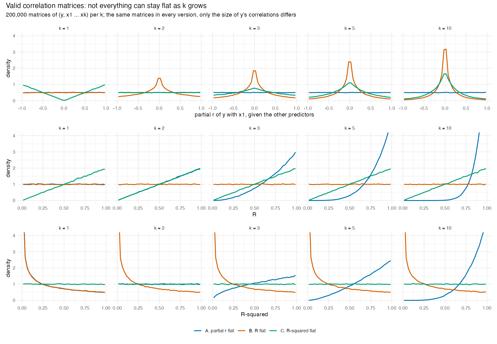
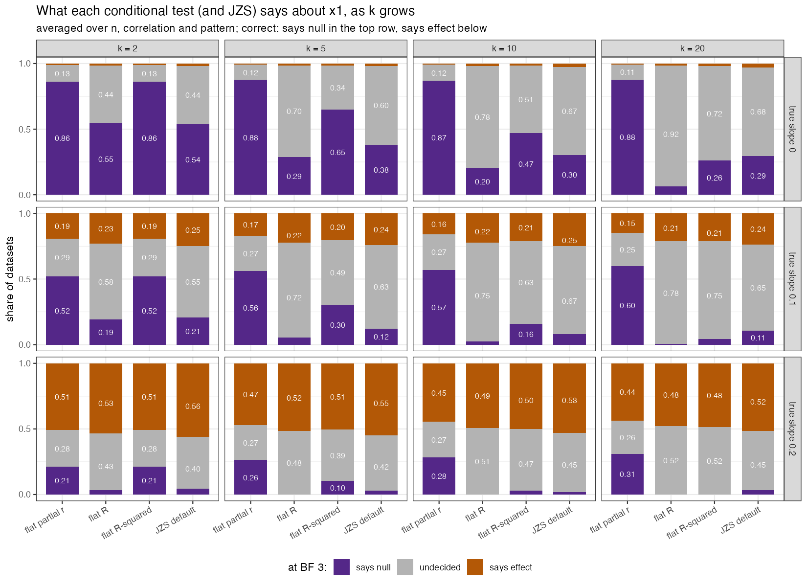
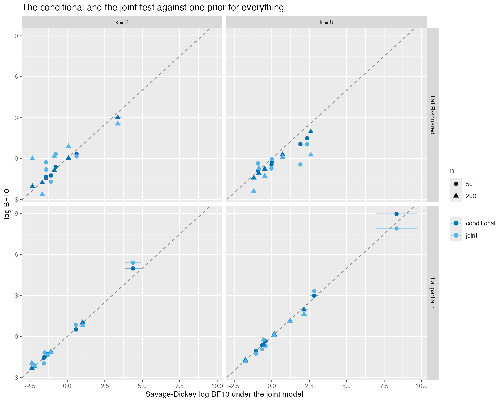

# What this project shows

When a default ("objective") Bayes factor is used to test one regression
coefficient, the evidence can depend on how many other predictors are in the
model. Whether it does depends on what the default prior keeps flat as
predictors are added. If each partial correlation is kept flat, the test of a
coefficient confirms true nulls at the same rate for any number of predictors
*k*. If the total (*R* or *R*²) is kept flat instead, the test drifts with
*k*. The drift does not make the test more accurate: the tests rank datasets
identically, and the drifting ones simply leave more of them undecided.

The numbers below come from the validation run of 4 November 2026 (commit
21d42dc), in which 137 of 138 checks passed. Each number names the study
that produced it; full results are in [`4_validation.md`](4_validation.md)
and [`../validation/report.html`](../validation/report.html).

---

## 1. Valid correlation matrices force a choice (study 00)

With one predictor, the natural default is Jeffreys' prior, which is flat on
the correlation between predictor and outcome. With several predictors, not
every correlation-based quantity can be flat at once. Study 00 draws random
valid correlation matrices of (*y*, *x*₁ … *x*ₖ) and keeps one quantity
flat in each of three versions:

- keeping each **partial correlation** (= the correlation of *y* with one
  predictor after removing the other predictors from both) flat makes *R*² grow with *k*: the
  probability that *R*² > .50 rises from .29 at *k* = 1 to .97 at *k* = 10;
- keeping the **multiple correlation** *R* or *R*² flat makes each partial
  correlation shrink with *k*: under flat *R*, the probability that a partial
  correlation exceeds .30 in absolute value falls from .70 at *k* = 1 to .22
  at *k* = 10.

The three versions are the three priors compared in this project. They form
one family, in which *R*² follows a Beta(*a*, 1) distribution and only the
shape *a* differs:

| Prior | *a* | Kept flat as predictors are added | Known as |
|---|---|---|---|
| flat partial r | *k*/2 | each partial correlation | LKJ(1); `stan_lm` with η = 1 |
| flat R | ½ | the multiple correlation *R* | |
| flat R-squared | 1 | *R*² | |

The simulated matrices follow these distributions for every *k*
(Kolmogorov–Smirnov distance at most .0026, .0024 and .0038 for the three
versions, with 200,000 matrices per *k*; checks F1–F3).

## 2. All three priors are computed correctly and meet the formal criteria (studies 01, 02, 05)

The comparison is between three correct implementations. For all three
priors, the Bayes factors agree with numerical integration, with brute-force
sampling and with a second derivation, and the Stan model passes
simulation-based calibration. All three also meet the default-prior criteria
of Bayarri et al. (2012) that were checked: predictive matching, invariance,
information consistency, model-selection consistency and intrinsic
consistency. These criteria are checked numerically in the settings studied,
not proven. The priors differ in how they behave, which the next sections
describe.

## 3. Under flat R and flat R-squared the test drifts with *k*, without gaining accuracy (studies 04, 06)

Study 06 covers 72 designs (*k* = 2, 5, 10 and 20; *n* = 50, 200 and 1,000;
predictor correlations 0, .30 and .70; the other coefficients sparse or
dense), each with three true slopes for the tested coefficient *x*₁ (0, 0.1
and 0.2, in units of the noise SD, with unit-variance predictors) and 200
datasets per cell. The other predictors are not unrelated: in the sparse
pattern one of them has slope 0.3, in the dense pattern all have slope 0.1.
In every design the three conditional tests (= the test of one coefficient's
partial correlation against zero, using the prior that the joint prior
implies for it) rank the datasets in the same order. Their ability to
separate a true null from a small effect (slope 0.1) is therefore
identical: the area under the ROC curve (AUC) is .701 for all three at
*k* = 20.

They differ in where they decide. At a Bayes factor of 3, each test either
supports the null (BF₀₁ > 3), supports an effect (BF₁₀ > 3), or is
undecided. At *k* = 20:

| True slope | Answer | flat partial r | flat R | flat R-squared |
|---|---|---|---|---|
| 0 (null) | null / undecided / effect | **.88** / .11 / .01 | **.06** / .92 / .01 | **.26** / .72 / .02 |
| 0.1 | null / undecided / effect | .60 / .26 / **.15** | .005 / .78 / **.21** | .04 / .75 / **.21** |

Correct answers are in bold. Under flat partial r, the share of true nulls
that is confirmed is about the same at *k* = 2 (.86) and *k* = 20 (.88). Its
other rates shift somewhat with *k*: the share of 0.1 effects it calls null
rises from .52 to .60, and the share of 0.2 effects it finds falls from .51
to .44.
Under flat R it falls from .55 to .06, so that at 20 predictors 92% of true
nulls stay undecided. Flat R rarely calls a small effect null (.005), but
that is because it rarely calls anything null. It finds a 0.1 effect about as
often as flat R-squared (.21) and JZS (.24), and more often than flat partial
r (.15); what it lacks is the ability to confirm a null.

## 4. Only flat partial r corresponds to one coherent model (study 10)

A test of one coefficient is coherent when it equals the Bayes factor of the
full model against the same model with that coefficient's partial
correlation fixed at zero. That Bayes factor can be estimated from the full
model's posterior with the Savage–Dickey density ratio (Wagenmakers et al.,
2010).

- Under flat partial r the conditional test matches it to within a factor
  of 1.10, on the 16 of 20 datasets where the Savage–Dickey ratio can be
  estimated (the other four agree within three Monte Carlo standard errors;
  study 10, P5).
- Under flat R-squared the two diverge as *k* grows, by a factor of up to
  2.40 at *k* = 8, over the 19 of 20 estimable datasets. This is the one
  failed check of the run (study 10, P4). It reflects the
  prior: the partial correlations are linked through *R*², so information
  about the other coefficients shifts the evidence for *x*₁.
- Under flat R the restricted model is not a proper alternative. The prior density of a
  single partial correlation at zero is infinite, and conditioning on that
  partial correlation being near zero pushes the other coefficients to zero
  as well (median *R*² of the other predictors .001 at *k* = 3 and .003 at
  *k* = 8, given that the partial correlation is below .005 in absolute
  value; study 10, P7), so the restricted model collapses to the
  intercept-only model. Under flat partial r and flat R-squared, the same
  restriction leaves a proper model (study 10, P6).

## 5. What flat partial r costs

- With a small effect it leans towards the null: at *k* = 20 it calls 60% of
  0.1 effects null (averaged over *n* = 50 to 1,000). A BF₀₁ above 3 from this prior
  therefore does not rule out a small effect, and is best reported together
  with the range of effects that the data cannot distinguish from zero (the
  support curve in `R/support_curve.R`).
- It shrinks the estimates less than flat R, so its predictions are
  somewhat worse with many predictors and a small sample: at *k* = 8 and
  *n* = 30 its prediction error is 0.72–0.81 times that of ordinary least
  squares, against 0.37–0.77 for flat R (study 07). In return its estimates
  are less biased (8% towards zero for a real effect, against 28% under flat
  R), and its 95% intervals keep coverage of .916 or higher (flat R: as low
  as .760).
- In variable selection it is conservative, like Zellner–Siow: it includes
  few null predictors but misses more real ones (study 09).

## 6. What is new and what is not

The test itself is not new. A flat prior on one partial correlation is the
test of Kucharský et al. (2026) with α = 1, and the joint prior is LKJ(1),
which is also `stan_lm` with η = 1. Two points were not found in the
literature searched: that this conditional test is the Bayes factor of one
joint model (and that under flat R the restricted model collapses), and that
for the conditional tests the drift of *R*-based and *R*²-based defaults with
*k* changes where the test decides, while their ability to separate nulls
from small effects stays the same. Their joint tests do separate worse than
JZS with correlated predictors (mean AUC .064 below JZS for flat R at
*k* = 2 and correlation .70; study 06). The search was not a systematic review;
[`relation_to_others.md`](relation_to_others.md) lists the sources and the
papers that still need a full reading.

---

**Recommendation** ([`3_comparison.md`](3_comparison.md), section 8): flat
partial r, with the costs in section 5 stated whenever it is used. The
package has no default prior; every function requires `prior =`.
